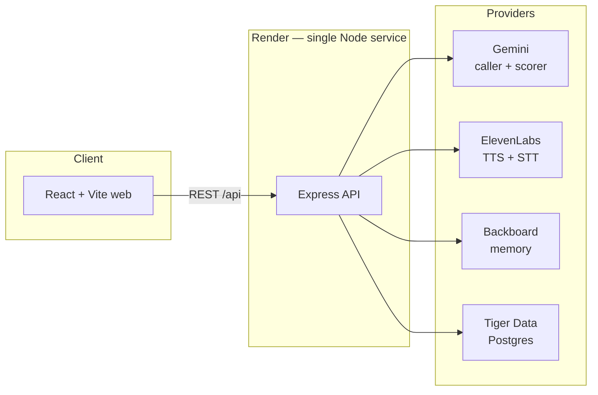

# First Line

**Hold the line.**

Winner, MLH Best Use of ElevenLabs — CodeRed Orion 2026 (UH)

[](https://first-line-cvjm.onrender.com)
[](./web)
[](./shared)
[](./server)
[](https://ai.google.dev/)
[](https://elevenlabs.io/)
[](https://www.tigerdata.com/)
[](https://first-line-cvjm.onrender.com)

**Live demo:** [https://first-line-cvjm.onrender.com](https://first-line-cvjm.onrender.com)

Crisis line volunteers often learn by shadowing and scarce roleplay. **First Line** gives them on-demand practice with realistic AI voice callers who react in the moment, remember past sessions, and surface a scored debrief — so trainees can build skill before they ever pick up a real line.

> **Training tool only — not a crisis service.** If you are in crisis, call or text **988** in the US (or visit [988lifeline.org](https://988lifeline.org)). In an emergency, call 911.

## Features

- **Callers who remember you** — per trainee–caller memory via [Backboard](https://www.backboard.ai/), so callbacks feel continuous
- **ElevenLabs expressive voices + STT** — spoken practice with push-to-talk transcription
- **Live distress / trust meter** — watch how each response moves the caller (0–100)
- **Gemini caller + scored debrief** — persona-driven turns and skill-focused feedback after the call
- **Readiness report** — practice history persisted in Tiger Data Postgres
- **Build-a-Caller** — create custom practice personas for targeted drills

## Architecture



| Layer | Role |
|---|---|
| `web/` | React + Vite + TypeScript UI |
| `server/` | Express routes, orchestration, provider adapters |
| `shared/types` | Shared JSON contracts |
| `db/` | Schema, seed, migrations |

## Tech stack

| Area | Choice |
|---|---|
| Frontend | React, Vite, TypeScript, Tailwind |
| Backend | Node.js 22, Express, TypeScript |
| AI caller / scoring | Google Gemini |
| Voice | ElevenLabs TTS + STT |
| Memory | Backboard |
| Data | Tiger Data (Postgres / Timescale-compatible) |
| Hosting | Render (API + static UI, one service) |

## Key engineering decisions

- **Swappable provider interfaces + mocks** — `AI_PROVIDER`, `VOICE_PROVIDER`, `MEMORY_PROVIDER`, and `REPO_PROVIDER` swap between mock and live backends so the full call flow works with zero API keys
- **Safe fallback on AI failure** — model errors become in-character safety responses; no raw stack traces in the trainee UI
- **Per trainee–caller memory scoping** — Backboard memory is scoped so one volunteer's history with Maya does not leak into another trainee's session
- **Push-to-talk over full duplex** — reliable PTT for hackathon demos; full-duplex interruption prototypes live on separate branches

## Local setup

Works with **no API keys** (mock defaults).

```bash
git clone https://github.com/scoot-skoot/codered-orion.git && cd codered-orion
npm install && npm run install:all
cp server/.env.example server/.env
cp web/.env.example web/.env
npm run dev
```

- Web: http://localhost:5173  
- API: http://localhost:3001/api/health  

Defaults: `AI_PROVIDER=mock`, `VOICE_PROVIDER=mock`, `MEMORY_PROVIDER=none`, `REPO_PROVIDER=memory`.

| Command | What it does |
|---|---|
| `npm run dev` | Server (:3001) + web (:5173) |
| `npm run smoke` | API smoke tests |
| `npm run db:reset` | Apply `db/schema.sql` + `db/seed.sql` |
| `npm run build` | Server `tsc` + Vite `web/dist` |
| `npm start` | Serve API + `web/dist` on `PORT` |
| `npm run typecheck` | Server `tsc` + web build |
| `npm run test` | Unit tests |

Flip providers to real by setting keys in `server/.env` (see `server/.env.example`). Deploy notes: [docs/DEPLOY.md](docs/DEPLOY.md).

## Team

- **[Teammate]**
- **David Ajao** ([@scoot-skoot](https://github.com/scoot-skoot))

Built at **CodeRed Orion 2026** (University of Houston).

## Responsible use

First Line is a **training simulator for volunteers**, not a substitute for professional crisis services, clinical supervision, or emergency response. Content is intentionally non-graphic. Persistent UI labeling and a 988 banner reinforce that boundary.

If you or someone you know is in crisis, **call or text 988** in the US.

## Docs

- [Design notes](docs/DESIGN.md)
- [Build spec](docs/AGENT_BUILD.md)
- [Deploy (Render)](docs/DEPLOY.md)
