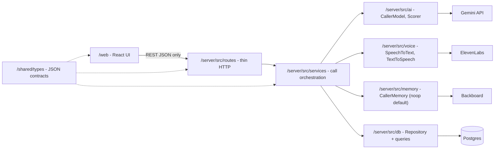

# AGENT_BUILD.md: First Line build spec for a coding agent

> **Training simulator only. Not a crisis service.** If you or someone you know is struggling, call or text **988** or chat at [988lifeline.org](https://988lifeline.org). In an emergency, call 911.

## Paste this into the Cursor agent to start

```text
Read docs/AGENT_BUILD.md fully, then skim docs/DESIGN.md for background
(AGENT_BUILD.md wins on any conflict). The repo scaffolding already exists
(server/, web/, shared/types/, db/). Implement milestone M0 only: the five
API smoke tests in server/scripts/smoke/ plus the npm scripts listed in §3,
each printing OK or FAIL. Work on branch feat/m0-smoke with small commits.
Never commit .env files or print secret values. When done, run
`npm run smoke` from the repo root, paste the output, check every M0
acceptance criterion, and stop for review before M1.
```

For each later milestone: *"Continue with M\<n\> from docs/AGENT_BUILD.md on branch feat/m\<n\>-\<name\>. Check every acceptance criterion and stop for review."*

---

## 1. Goal and context

The team is building **First Line** at CodeRED Orion (Oct 10–11, 2026), a one-day hackathon. Trainee crisis line volunteers practice with a simulated caller: **Gemini** plays the caller from a scenario persona, **ElevenLabs** voices it and transcribes the trainee, and after the call Gemini scores the trainee's skills. The caller has a **live distress number (0–100)** that rises or falls with each response and is shown as a meter. Sessions are saved in **Postgres**.

Target prize tracks: Gemini API, ElevenLabs, Backboard (sponsor track; see E1), and optionally Tiger Data (Postgres/Timescale).

**Priorities, in order:** a working, demoable MVP; clean module boundaries so three people can work in parallel against mocks; text chat always working as a fallback.

### Scope

| | Feature | Milestone |
|---|---|---|
| **MVP** | Smoke tests proving every API key and the DB work | M0 |
| **MVP** | Text call loop (trainee types → Gemini caller replies), persisted to Postgres | M1 |
| **MVP** | Push-to-talk voice: ElevenLabs STT in, ElevenLabs TTS out | M2 |
| **MVP** | Distress number 0–100 in every caller turn's JSON, a basic live meter, saved per turn | M3 |
| **MVP** | Post-call scoring + debrief (structured JSON from Gemini) | M4 |
| E1 | Backboard callback memory (callers who remember). Smoke test in M0; `NoopMemory` stub in M1 | Extension 1 |
| E2 | Voice delivery changes with distress (voice settings / audio tags) | Extension 2 |
| E3 | Gamification: progress chart, streaks, leaderboard (David writes the SQL) | Extension 3 |
| E4 | Replay and rewind: branch a past session from a chosen turn | Extension 4 |
| Cut | Auth, full-duplex voice, ElevenLabs Agents, Tiger Data hypertables, scenario editor, deployment | Not in this spec |

---

## 2. Module boundaries and owners

The rule: **each module talks to its neighbors only through a TypeScript interface or the REST API.** Every external service sits behind an adapter with a **mock implementation**, so anyone can run the whole app with no API keys.



| Module | Responsibility | May import | Must NOT | Owner |
|---|---|---|---|---|
| `/shared/types/index.ts` | Single source of truth for REST request/response types and the Gemini JSON shapes. **Type-only** (no runtime imports), because `shared/` has no `node_modules` of its own | nothing | Contain logic, I/O, or imports from npm packages | David (changes reviewed by all) |
| `/web` | UI only: call queue, call screen, meter, debrief, 988 banner | `shared/types`, React libs | Call Gemini/ElevenLabs/Backboard/DB directly; hold API keys | Freshman |
| `/server/src/routes` | Parse/validate HTTP (Zod schemas in `server/src/validation.ts` that mirror `shared/types`), call a service, map errors to status codes | services, validation, shared | Contain business logic, SQL, or SDK calls | David |
| `/server/src/services` | Call orchestration: start call, take turn, end call, distress clamping, safety fallback | interfaces from ai/voice/memory/db, shared | Import any vendor SDK or `pg` directly | David (pairs with DS) |
| `/server/src/ai` | `CallerModel` + `Scorer`: prompts, JSON schemas, Gemini client, mocks | `@google/genai`, shared | Touch HTTP or DB | DS student |
| `/server/src/voice` | `SpeechToText` + `TextToSpeech`: ElevenLabs adapter, mocks | `@elevenlabs/elevenlabs-js` | Know about sessions/DB | DS student (David reviews) |
| `/server/src/memory` | `CallerMemory`: `NoopMemory` default, `BackboardMemory` in E1 | `backboard-sdk` | Be required for the MVP to work | DS student |
| `/server/src/db` | `Repository` (Postgres + in-memory), `queries.ts` (hand-written analytics SQL) | `pg` | Contain prompt/AI logic | David |
| `/db` | `schema.sql`, `seed.sql` | n/a | n/a | David |
| `/server/scripts` | Smoke tests, `db-reset.ts` (they live under `server/` so they resolve server dependencies) | server adapters | n/a | Agent scaffolds |

**Provider switches (in `server/.env`):** `AI_PROVIDER=mock|gemini`, `VOICE_PROVIDER=mock|elevenlabs`, `MEMORY_PROVIDER=none|backboard`, `REPO_PROVIDER=memory|postgres`. Unset values default to `mock` / `none` / `memory`, so `npm run dev` works on a fresh clone with no keys. Add these to `server/src/config.ts` (it already loads dotenv and warns on missing keys; keep it **never logging values**) and to `server/.env.example`. A small `server/src/container.ts` builds the right implementations from config (plain factory functions; no DI framework).

---

## 3. Repo layout (existing scaffold + what to add)

The scaffold is in `main` (commit `aa940e9`). Package manager is **npm**, with **separate installs** per app (`npm run install:all` → `server/` and `web/`), not workspaces. Node 20+, TypeScript, ESM. Items marked **(add)** are created by the milestone in brackets.

```text
codered-orion/
├── package.json              # root: install:all, dev (concurrently server+web); add forwarding scripts below [M0]
├── README.md  .gitignore
├── docs/                     # DESIGN.md, DESIGN.pdf, AGENT_BUILD.md
├── shared/
│   └── types/index.ts        # exists (CallerTurn). Add all contracts from §4 [M1]. Type-only.
├── db/
│   ├── schema.sql            # placeholder; fill from §4.5 [M1]
│   └── seed.sql              # (add) [M1]
├── scripts/                  # exists (.gitkeep); leave empty or for shell helpers
├── server/
│   ├── package.json          # dev: tsx watch src/index.ts
│   ├── .env.example          # exists; add *_PROVIDER, GEMINI_MODEL, ELEVENLABS_* vars [M0]
│   ├── scripts/              # (add) [M0]
│   │   ├── smoke/gemini.ts  tts.ts  stt.ts  backboard.ts  db.ts  all.ts
│   │   └── db-reset.ts       # applies ../db/schema.sql then ../db/seed.sql via pg [M1]
│   ├── assets/mock.mp3       # (add) tiny clip for MockVoice [M2]; keep < 50 KB (note: *.mp3 is gitignored, so add a !server/assets/*.mp3 exception)
│   └── src/
│       ├── index.ts          # exists: express + cors + /api/health
│       ├── config.ts         # exists: env loading
│       ├── container.ts      # (add) [M1]
│       ├── validation.ts     # (add) Zod schemas mirroring shared/types [M1]
│       ├── routes/           # (add) health.ts, scenarios.ts, sessions.ts, trainees.ts [M1]
│       ├── services/         # (add) callService.ts, distress.ts, safety.ts [M1/M3]
│       ├── ai/               # (add) types.ts, geminiCaller.ts, geminiScorer.ts, mockCaller.ts, mockScorer.ts, prompts/caller.md, prompts/scorer.md
│       ├── voice/            # (add) types.ts, elevenlabs.ts, mockVoice.ts [M2]
│       ├── memory/           # (add) types.ts, noopMemory.ts [M1]; backboardMemory.ts [E1]
│       └── db/               # (add) types.ts, pool.ts, pgRepository.ts, memoryRepository.ts, queries.ts [M1]
└── web/                      # Vite react-ts template (exists)
    ├── .env.example          # VITE_API_URL=http://localhost:3001 (no keys ever)
    └── src/
        ├── api/client.ts     # (add) the ONLY place that calls fetch(); base = import.meta.env.VITE_API_URL [M1]
        ├── mocks/            # (add) canned API responses so UI work needs no server [M1]
        ├── components/       # (add) CrisisBanner, ScenarioCard, CallScreen, Transcript,
        │                     #       PushToTalkButton [M2], DistressMeter [M3], DebriefCard [M4]
        └── pages/            # (add) Home.tsx, Call.tsx, Debrief.tsx
```

**Importing shared types:** server: a relative `import type`, e.g. from `server/src/index.ts`: `import type { CallerTurn } from "../../shared/types/index.js";` (or add a `paths` alias `@shared/*` in `server/tsconfig.json`, and make sure `tsc` `rootDir`/`include` allow it; tsx handles either). Web: add a Vite `resolve.alias` `@shared` → `../shared/types` plus a matching `paths` entry in `web/tsconfig.app.json`. Use `import type` only.

**Scripts to add.** `server/package.json`:

```json
{
  "smoke": "tsx scripts/smoke/all.ts",
  "smoke:gemini": "tsx scripts/smoke/gemini.ts",
  "smoke:tts": "tsx scripts/smoke/tts.ts",
  "smoke:stt": "tsx scripts/smoke/stt.ts",
  "smoke:backboard": "tsx scripts/smoke/backboard.ts",
  "smoke:db": "tsx scripts/smoke/db.ts",
  "db:reset": "tsx scripts/db-reset.ts",
  "typecheck": "tsc --noEmit"
}
```

Root `package.json` (forwarders): `"smoke": "npm run smoke --prefix server"`, `"db:reset": "npm run db:reset --prefix server"`, `"typecheck": "npm run typecheck --prefix server && npm run build --prefix web"`. Keep the existing `dev` and `install:all`.

---

## 4. Contracts

### 4.1 Adapter interfaces (server)

```ts
// server/src/ai/types.ts
import type { CallerTurn, ScoringOutput, Persona, Scenario, TurnRecord } from "../../../shared/types/index.js";

export interface CallerTurnInput {
  persona: Persona;
  scenario: Scenario;
  history: TurnRecord[];          // full transcript so far, oldest first (stateless calls)
  currentDistress: number;        // 0-100, last caller state (or scenario.initialDistress)
  memories: string[];             // from CallerMemory.recall; [] in the MVP
  isOpening: boolean;             // true -> produce the caller's first line
}
export interface CallerModel { nextTurn(input: CallerTurnInput): Promise<CallerTurn>; }

export interface ScoringInput { persona: Persona; scenario: Scenario; history: TurnRecord[]; }
export interface Scorer { score(input: ScoringInput): Promise<ScoringOutput>; }

// server/src/voice/types.ts
export interface SpeechToText { transcribe(audio: Buffer, mimeType: string): Promise<string>; }
export interface TtsOptions { voiceId: string; distress?: number; emotion?: string; } // distress/emotion used in E2
export interface TextToSpeech { stream(text: string, opts: TtsOptions): Promise<NodeJS.ReadableStream>; }

// server/src/memory/types.ts
export interface CallerMemory {
  recall(traineeId: string, personaId: string): Promise<string[]>;           // NoopMemory -> []
  remember(traineeId: string, personaId: string, facts: string[]): Promise<void>; // NoopMemory -> no-op
}

// server/src/db/types.ts
export interface Repository {
  listScenarios(): Promise<ScenarioSummary[]>;
  getScenarioWithPersona(scenarioId: string): Promise<{ scenario: Scenario; persona: Persona }>;
  listTrainees(): Promise<Trainee[]>;
  createSession(s: NewSession): Promise<SessionRecord>;
  getSession(id: string): Promise<SessionDetail | null>;          // session + turns + debrief
  appendTurn(t: NewTurn): Promise<TurnRecord>;                     // assigns seq atomically
  completeSession(id: string, debrief: ScoringOutput, overall: number): Promise<void>; // one transaction
  listSessionsForTrainee(traineeId: string): Promise<SessionSummary[]>;
}
```

Mocks: `MockCaller` cycles through canned lines and moves distress −10 for turns containing "sounds like" / "feel" / "?" and +10 otherwise; `MockScorer` returns a fixed valid `ScoringOutput`; `MockVoice` returns the fixed transcript "this is a mock transcript" and a short silent/beep MP3 from `server/assets/`; `memoryRepository` keeps everything in Maps seeded from the same data as `db/seed.sql`.

### 4.2 Gemini caller-turn JSON (per turn)

TypeScript, in `shared/types/index.ts`. The scaffold already has `CallerTurn`; tighten it to this (make `trust` required and `emotion` an enum). Put the matching Zod schema in `server/src/validation.ts` and the plain JSON Schema below in `server/src/ai/schemas.ts`:

```ts
export type Emotion = "calm" | "anxious" | "tearful" | "irritated" | "angry" | "flat" | "relieved";
export interface CallerTurn {
  caller_line: string;               // exactly what the caller says aloud, 1-3 sentences
  emotion: Emotion;
  distress: number;                  // 0-100, NEW level after the trainee's last message
  trust: number;                     // 0-100, trust in the volunteer (stored; meter in E2/E3)
  revealed_warning_signs: string[];  // warning-sign codes hinted at in THIS line
  should_end_call: boolean;
}
```

JSON Schema passed to Gemini (only the supported subset: type, properties, required, enum, minimum/maximum, items):

```json
{
  "type": "object",
  "properties": {
    "caller_line": { "type": "string", "description": "What the caller says aloud. 1-3 short sentences. No stage directions." },
    "emotion": { "type": "string", "enum": ["calm", "anxious", "tearful", "irritated", "angry", "flat", "relieved"] },
    "distress": { "type": "integer", "minimum": 0, "maximum": 100, "description": "Caller distress AFTER hearing the volunteer's last message." },
    "trust": { "type": "integer", "minimum": 0, "maximum": 100 },
    "revealed_warning_signs": { "type": "array", "items": { "type": "string", "enum": ["hopelessness", "perceived_burden", "recent_loss", "withdrawal", "access_to_means", "prior_attempt", "substance_use", "giving_things_away"] } },
    "should_end_call": { "type": "boolean" }
  },
  "required": ["caller_line", "emotion", "distress", "trust", "revealed_warning_signs", "should_end_call"]
}
```

**Server-side rules (services/distress.ts), not the model's job:**
- Clamp to 0–100, and cap the change at **±20 per turn** relative to the previous value (keeps the meter believable). Store the model's raw value in `turns.state` and the clamped value in `turns.distress`.
- Opening turn: `distress = scenario.initial_distress` and `trust = 30`, unless the model returns something within ±10.
- Filter `revealed_warning_signs` to codes present in `scenario_warning_signs`.

**Distress guidance in the caller prompt:** validation, reflections, open questions, and calm pacing lower distress (typically −5 to −15); judgment, advice-giving, minimizing, rushing, or ignoring a disclosure raise it (+5 to +20). Asking directly and caringly about suicide should not raise distress by itself.

### 4.3 Scoring JSON (end of call)

Rubric is the five skills from DESIGN.md §8, each scored 0–4. Copy the prompt text from DESIGN.md §8.2 into `server/src/ai/prompts/scorer.md` and add one line: "Distress readings per turn are provided; reference moments where distress rose or fell in evidence."

```ts
export type Skill = "active_listening" | "empathy" | "de_escalation" | "risk_assessment" | "warning_sign_recognition";
export interface ScoringOutput {
  skills: { skill: Skill; score: number; evidence_quote: string; evidence_turn_seq: number | null; rationale: string }[]; // exactly 5
  warning_signs: { code: string; status: "caught" | "partial" | "missed"; surfaced_turn_seq: number; response_turn_seq: number | null; explanation: string }[];
  asked_directly_about_suicide: boolean;
  summary: string;        // 2-3 supportive sentences
  strengths: string[];    // max 3
  next_steps: string[];   // max 3
}
```

The JSON Schema mirrors this (use `"type": ["integer","null"]` for nullable ints, `minimum`/`maximum` 0–4 on `score`, `minItems`/`maxItems` 5 on `skills`). **Overall score is computed in code**, not by the model: `round(100 * Σ(weight·score) / 4)` with weights risk_assessment 0.30, warning_sign_recognition 0.20, active_listening 0.20, empathy 0.15, de_escalation 0.15.

### 4.4 REST API (MVP)

Base `/api`, JSON unless noted. Validate every body with the Zod schemas in `server/src/validation.ts` (which mirror `shared/types`). Error shape everywhere: `{ "error": { "code": "VALIDATION_ERROR", "message": "...", "details": {} } }` with 400/404/409/422/500/502 (502 = upstream AI/voice failure after fallback).

| Method | Path | Request | Response |
|---|---|---|---|
| GET | `/api/health` | n/a | `{ "ok": true, "providers": { "ai": "gemini", "voice": "mock", "memory": "none", "repo": "postgres" } }` |
| GET | `/api/trainees` | n/a | `{ "trainees": [{ "id": "uuid", "displayName": "Demo Trainee" }] }` |
| GET | `/api/scenarios` | n/a | `{ "scenarios": [ScenarioSummary] }` |
| POST | `/api/sessions` | `{ "traineeId": "uuid", "scenarioId": "uuid", "mode": "text" \| "voice" }` | `201 { "session": SessionRecord, "openingTurn": CallerTurnView }` |
| POST | `/api/sessions/:id/turns` | JSON `{ "text": "..." }` **or** `multipart/form-data` with field `audio` (webm/ogg/mp3/wav, ≤ 5 MB) | `201 { "traineeTurn": TurnView, "callerTurn": CallerTurnView, "callEnded": boolean }` |
| GET | `/api/sessions/:id/turns/:seq/audio` | n/a | `audio/mpeg`, streamed (caller turns only) |
| POST | `/api/sessions/:id/end` | `{}` | `200 { "debrief": DebriefView }` (idempotent: a second call returns the stored debrief) |
| GET | `/api/sessions/:id` | n/a | `{ "session": SessionRecord, "turns": [TurnView], "debrief": DebriefView \| null }` |
| GET | `/api/trainees/:id/sessions` | n/a | `{ "sessions": [SessionSummary] }` |

Example JSON:

```jsonc
// ScenarioSummary
{ "id": "uuid", "title": "Can't sleep, can't stop thinking", "personaName": "Ray", "difficultyTier": 2,
  "contentNotes": ["job loss", "hopelessness", "suicidal thoughts (non-graphic)"], "initialDistress": 65 }

// SessionRecord
{ "id": "uuid", "traineeId": "uuid", "scenarioId": "uuid", "mode": "voice",
  "status": "in_progress", "startedAt": "2026-10-10T20:15:00Z", "endedAt": null, "overallScore": null }

// TurnView (trainee) / CallerTurnView (caller adds the fields after "text")
{ "seq": 7, "speaker": "caller", "text": "Yeah... I guess. I just don't see the point anymore.",
  "emotion": "flat", "distress": 72, "trust": 35, "revealedWarningSigns": ["hopelessness"],
  "audioUrl": "/api/sessions/uuid/turns/7/audio", "safetyFallback": false, "createdAt": "..." }

// POST /api/sessions/:id/turns response
{ "traineeTurn": { "seq": 6, "speaker": "trainee", "text": "That sounds really heavy. Can you tell me more?", "createdAt": "..." },
  "callerTurn": { "...": "CallerTurnView as above" },
  "callEnded": false }

// DebriefView = ScoringOutput (camelCased) + { "overallScore": 74, "distressCurve": [{ "seq": 1, "distress": 65 }, ...] }
```

Rules: `409` when posting a turn to a non-`in_progress` session. If `callEnded` is true, the UI shows "Caller ended the call" and offers End & Debrief. Audio URL is null when `VOICE_PROVIDER=mock` and the mock has no asset.

**Extension endpoints (do not build in MVP):** E3 `GET /api/leaderboard?window=7d`, `GET /api/trainees/:id/progress?days=14` (both call hand-written queries in `queries.ts`); E4 `POST /api/sessions/:id/branch { "fromSeq": 6 }` → new session copying turns 1..fromSeq and their state.

### 4.5 Database schema (`db/schema.sql`)

Reuses DESIGN.md §6, trimmed to the MVP plus the one table E1 needs. **New vs. DESIGN.md:** state columns on `turns` (`distress`, `trust`, `emotion`, `state jsonb`), `scenarios.initial_distress`, and `sessions.parent_session_id` / `branched_from_seq` (reserved for E4).

```sql
-- db/schema.sql  (idempotent for db:reset: drop + create)
CREATE EXTENSION IF NOT EXISTS pgcrypto;

DROP TABLE IF EXISTS session_warning_signs, scores, debriefs, turns, sessions,
  caller_relationships, scenario_warning_signs, warning_signs, scenarios, personas, trainees CASCADE;

CREATE TABLE trainees (
  id            uuid PRIMARY KEY DEFAULT gen_random_uuid(),
  display_name  text NOT NULL,
  leaderboard_opt_in boolean NOT NULL DEFAULT false,   -- E3; private by default
  created_at    timestamptz NOT NULL DEFAULT now()
);

CREATE TABLE personas (
  id                uuid PRIMARY KEY DEFAULT gen_random_uuid(),
  slug              text UNIQUE NOT NULL,
  name              text NOT NULL,
  age               smallint,
  voice_id          text,                       -- ElevenLabs voice id
  backstory         text NOT NULL,
  speaking_style    text NOT NULL,
  baseline_emotion  text NOT NULL,
  is_recurring      boolean NOT NULL DEFAULT false,
  content_notes     text[] NOT NULL DEFAULT '{}'
);

CREATE TABLE scenarios (
  id                  uuid PRIMARY KEY DEFAULT gen_random_uuid(),
  persona_id          uuid NOT NULL REFERENCES personas(id),
  title               text NOT NULL,
  call_number         smallint NOT NULL DEFAULT 1,
  difficulty_tier     smallint NOT NULL CHECK (difficulty_tier BETWEEN 1 AND 4),
  situation_brief     text NOT NULL,
  hidden_state        text NOT NULL,
  expected_risk_level text NOT NULL CHECK (expected_risk_level IN ('low','moderate','high')),
  initial_distress    smallint NOT NULL DEFAULT 60 CHECK (initial_distress BETWEEN 0 AND 100),
  is_active           boolean NOT NULL DEFAULT true
);

CREATE TABLE warning_signs (
  id            smallserial PRIMARY KEY,
  code          text UNIQUE NOT NULL,
  label         text NOT NULL,
  fcp_category  text NOT NULL CHECK (fcp_category IN ('desire','intent','capability','buffers'))
);

CREATE TABLE scenario_warning_signs (
  scenario_id      uuid REFERENCES scenarios(id) ON DELETE CASCADE,
  warning_sign_id  smallint REFERENCES warning_signs(id),
  cue_hint         text NOT NULL,
  PRIMARY KEY (scenario_id, warning_sign_id)
);

-- E1 (Backboard): one assistant per (trainee, persona). Created now so E1 needs no migration.
CREATE TABLE caller_relationships (
  trainee_id              uuid REFERENCES trainees(id),
  persona_id              uuid REFERENCES personas(id),
  backboard_assistant_id  text,
  calls_completed         smallint NOT NULL DEFAULT 0,
  PRIMARY KEY (trainee_id, persona_id)
);

CREATE TABLE sessions (
  id                 uuid PRIMARY KEY DEFAULT gen_random_uuid(),
  trainee_id         uuid NOT NULL REFERENCES trainees(id),
  scenario_id        uuid NOT NULL REFERENCES scenarios(id),
  persona_id         uuid NOT NULL REFERENCES personas(id),
  mode               text NOT NULL CHECK (mode IN ('text','voice')),
  status             text NOT NULL DEFAULT 'in_progress' CHECK (status IN ('in_progress','completed','abandoned')),
  started_at         timestamptz NOT NULL DEFAULT now(),
  ended_at           timestamptz,
  overall_score      smallint CHECK (overall_score BETWEEN 0 AND 100),
  parent_session_id  uuid REFERENCES sessions(id),   -- E4 replay/branch
  branched_from_seq  int                              -- E4
);
CREATE INDEX sessions_trainee_ended_idx ON sessions (trainee_id, ended_at);

CREATE TABLE turns (
  id                      bigserial PRIMARY KEY,
  session_id              uuid NOT NULL REFERENCES sessions(id) ON DELETE CASCADE,
  seq                     int NOT NULL,
  speaker                 text NOT NULL CHECK (speaker IN ('trainee','caller')),
  text                    text NOT NULL,
  -- caller emotional state AFTER this caller turn (NULL on trainee turns)
  distress                smallint CHECK (distress BETWEEN 0 AND 100),
  trust                   smallint CHECK (trust BETWEEN 0 AND 100),
  emotion                 text,
  revealed_warning_signs  text[] NOT NULL DEFAULT '{}',
  state                   jsonb,          -- raw model output + clamping info + safetyFallback flag
  latency_ms              int,
  created_at              timestamptz NOT NULL DEFAULT now(),
  UNIQUE (session_id, seq)
);

CREATE TABLE debriefs (
  session_id  uuid PRIMARY KEY REFERENCES sessions(id) ON DELETE CASCADE,
  summary     text NOT NULL,
  strengths   jsonb NOT NULL,
  next_steps  jsonb NOT NULL,
  asked_directly_about_suicide boolean NOT NULL,
  model       text NOT NULL,
  raw_json    jsonb NOT NULL,
  created_at  timestamptz NOT NULL DEFAULT now()
);

CREATE TABLE scores (                       -- long format: one row per session x skill
  session_id         uuid REFERENCES sessions(id) ON DELETE CASCADE,
  skill              text CHECK (skill IN ('active_listening','empathy','de_escalation','risk_assessment','warning_sign_recognition')),
  score              smallint NOT NULL CHECK (score BETWEEN 0 AND 4),
  evidence           text,
  evidence_turn_seq  int,
  PRIMARY KEY (session_id, skill)
);

CREATE TABLE session_warning_signs (
  session_id         uuid REFERENCES sessions(id) ON DELETE CASCADE,
  warning_sign_id    smallint REFERENCES warning_signs(id),
  status             text NOT NULL CHECK (status IN ('caught','partial','missed')),
  surfaced_turn_seq  int,
  response_turn_seq  int,
  PRIMARY KEY (session_id, warning_sign_id)
);
```

`db/seed.sql`: one demo trainee ("Demo Trainee"), the eight warning signs from §4.2 with FCP categories (hopelessness/perceived_burden/recent_loss/withdrawal → desire; giving_things_away → intent; access_to_means/prior_attempt/substance_use → capability), and **three scenarios**: Tier 1 "Maya" (exam stress, loneliness, low risk, initial_distress 55), Tier 2 "Ray" call 1 (job loss, hopelessness, perceived burden, moderate, 65; content from DESIGN.md §12.1), Tier 3 "Dana" (irritated, frustrated with services, moderate, 70). Content must be non-graphic (see §8). Use fixed UUIDs in the seed so the in-memory repository and Postgres share ids.

---

## 5. Milestones and acceptance criteria

The MVP is **M0–M4**. Stop for human review after each milestone. **MVP freeze after M4**; extensions only after that, in order E1 → E4.

### M0: Smoke tests (scaffolding already exists)

Build `server/scripts/smoke/{gemini,tts,stt,backboard,db}.ts` and `all.ts`, plus the npm scripts in §3. Each script loads `server/.env` through `src/config.ts` and prints exactly one line: `[OK]`, `[FAIL]` (with a short reason), and the elapsed time. `all.ts` runs all five and exits non-zero if any fail. A missing env var is a FAIL that names the variable, never its value.

| Test | What it does | OK when |
|---|---|---|
| `gemini` | One caller-turn call using the §4.2 JSON Schema and a tiny test persona | Response parses and has a `caller_line` string and an integer `distress` 0–100 |
| `tts` | Streams "This is a First Line voice test." with `ELEVENLABS_DEFAULT_VOICE_ID` and the default TTS model; writes `/tmp/steadyline-smoke.mp3` (filename kept for script compatibility) | More than 1 KB of audio received |
| `stt` | Generates TTS audio of "testing one two three", then transcribes it with Scribe | Transcript contains "testing" (case-insensitive). If TTS fails, report `FAIL (tts dependency)` |
| `backboard` | Creates assistant `steadyline-smoke-<timestamp>` (prefix kept for script compatibility), adds one memory, searches for it (retries for up to ~10 s because memory writes can be async), then **deletes the assistant** | Create + add + delete succeed. Print `[OK] (search: found)` or `[OK] (search: pending)` |
| `db` | Connects with `DATABASE_URL`, runs `SELECT 1`, and reports whether the `sessions` table exists yet | `SELECT 1` succeeds (missing tables are just a note before M1) |

**Acceptance:** `npm run smoke` from the repo root prints five lines with valid keys and exits 0. With `GEMINI_API_KEY` unset, the gemini line says `FAIL missing env GEMINI_API_KEY` and the exit code is 1. No secret appears in the output. `server/.env.example` lists the new vars from §6. Committed on `feat/m0-smoke`.

### M1: Text call loop, persisted

Build the shared contracts (§4), `validation.ts`, `container.ts`, the ai/memory/db interfaces with mocks (`MockCaller`, `MockScorer`, `NoopMemory`, `memoryRepository`), `pgRepository`, `db/schema.sql` + `db/seed.sql` + `db:reset`, the MVP routes (all of §4.4 except audio and `/end`), `GeminiCaller`, `services/callService.ts` with the safety fallback, and in `/web`: `api/client.ts`, `CrisisBanner`, a Home page listing scenarios, and a Call page with transcript and text input.

**Acceptance:**
- All-mock mode (no `.env`): `npm run dev` → Home shows 3 scenarios → start a call → the opening line appears → 5 typed exchanges work → reload the page and the transcript is still there (in-memory repo).
- `AI_PROVIDER=gemini REPO_PROVIDER=postgres`, after `npm run db:reset`: same flow with real caller replies. `SELECT count(*) FROM turns WHERE session_id = '<id>'` returns 11 (1 opening + 5×2). Restart the server and `GET /api/sessions/:id` returns the full transcript.
- Every caller turn row has `distress`, `trust`, `emotion`, and `state` filled.
- Forcing `GeminiCaller` to throw (for example, an invalid model name) gives the in-character fallback line with `safetyFallback: true`, no HTTP 500, and the UI keeps working.
- The 988 banner and the "Training simulator only" label are visible on every page.
- `npm run typecheck` passes. `routes/` contains no SQL or SDK imports (grep check).

### M2: Push-to-talk voice (text stays available)

Build `voice/types.ts`, `voice/elevenlabs.ts`, and `voice/mockVoice.ts`; multipart upload on `POST /turns` (`multer`, memory storage, 5 MB limit); `GET /turns/:seq/audio` streaming `audio/mpeg`; and in `/web`, a `PushToTalkButton` (hold to record with `MediaRecorder`, release to upload) with auto-play of the caller audio. A Text/Voice toggle and the text box always stay on screen.

**Acceptance:**
- Speaking a sentence shows the transcribed text as the trainee turn, and caller audio starts playing. `turns.latency_ms` is logged and the median is under ~4 s across 5 turns. Record the numbers in the PR.
- The opening caller line also plays as audio.
- `VOICE_PROVIDER=mock` works end to end with the mock transcript and mock audio.
- Denying mic permission shows a message and falls back to text mode. If an STT/TTS call fails, the turn still completes as text with a toast.

### M3: Distress meter

Build `services/distress.ts` (clamp 0–100, ±20 cap per turn, opening rule, warning-sign filter; §4.2) and `DistressMeter` in `/web`: a horizontal 0–100 bar with three color bands (0–39 calm, 40–69 elevated, 70–100 high), the number, a ▲/▼ change indicator, and a small inline-SVG sparkline of this session's distress history (no chart library). It updates on every caller turn.

**Acceptance:**
- Unit tests (`node:test` via tsx) for the clamp rules: 7 cases including the ±20 cap, out-of-range values, and the opening value.
- Scripted run against real Gemini on the Ray scenario: 3 dismissive replies ("just calm down", "others have it worse") raise distress overall, and 3 validating replies lower it. Paste the values in the PR.
- `GET /api/sessions/:id` returns distress per caller turn, and the meter rebuilds correctly after a page reload.
- The meter is readable at a glance from about 2 m away on a laptop screen (large number, high contrast).

### M4: Scoring and debrief

Build `GeminiScorer` (prompt from DESIGN.md §8.2 plus the distress line, schema from §4.3), `POST /api/sessions/:id/end` (score, compute the overall score in code, write `scores` + `debriefs` + `session_warning_signs` + `sessions.status/ended_at/overall_score` in **one transaction**, call `CallerMemory.remember` which is a no-op in the MVP), and in `/web` a Debrief page: overall score, 5 skill bars (0–4) each with an evidence quote and turn number, warning signs caught/partial/missed, the distress curve (SVG), summary, strengths, and next steps.

**Acceptance:**
- After ending a real call: 5 rows in `scores`, 1 row in `debriefs`, `sessions.status = 'completed'`, and `overall_score` set. Calling `POST /end` again returns the same debrief without re-scoring.
- If the scorer returns invalid JSON, it retries once and then returns 502 `SCORING_FAILED`. The UI shows "Debrief unavailable, try again," and the session stays retryable.
- The mock scorer path works with no keys.
- Debrief appears within ~15 s with a visible loading state.
- **MVP freeze:** `main` is tagged `mvp-v1` after this merges.

### Extensions (after MVP freeze, in order)

| | Build | Acceptance |
|---|---|---|
| **E1 Backboard memory** | `memory/backboardMemory.ts` implementing `CallerMemory`. Lazily create one assistant per (trainee, persona) and store its id in `caller_relationships`. `recall` = `searchMemories(assistantId, "previous calls with the volunteer", 10)`. `remember` = ask Gemini for 3–6 short caller-point-of-view facts about the finished call, then `addMemory` each one with metadata `{ sessionId }`. Add Ray call 2 (`call_number = 2`) to the seed; inject memories into the caller prompt. | Ray call 2's opening references a fact from call 1. With `MEMORY_PROVIDER=none`, everything still works. Backboard errors never break a call: log them and continue with `[]`. |
| **E2 Distress-driven voice** | In `elevenlabs.ts`, map `TtsOptions.distress`/`emotion` to `voiceSettings`, e.g. `stability = 0.75 − 0.5·d`, `style = 0.1 + 0.4·d`, `speed = 1.0 − 0.1·d` with `d = distress/100`. Optionally switch to `eleven_v4_turbo` and prepend audio tags (`[sighs]`, `[crying]`, `[shaky]`-style) by emotion (VERIFY which tags and settings the chosen model honors). | Distress 85 vs. 25 sounds clearly different on the same line. Median latency stays under ~4 s. |
| **E3 Gamification** | Endpoints `/api/leaderboard` and `/api/trainees/:id/progress` that call the `queries.ts` functions (David implements the SQL). Progress chart (add `recharts` to web), "Eyes open" streak badge. | David's queries return data, the chart renders per-skill lines, and the leaderboard shows opt-in trainees only. |
| **E4 Replay and rewind** | `POST /api/sessions/:id/branch { fromSeq }` creates a new session with `parent_session_id`/`branched_from_seq`, copying turns 1..fromSeq including `distress/trust/state`. In the UI, add a "Try a different response from here" action on past trainee turns in the debrief transcript. | A branch resumes with the stored distress at that turn, and the original session is untouched. |

---

## 6. Third-party integration notes

Put new optional vars in `server/.env.example` during M0: `AI_PROVIDER`, `VOICE_PROVIDER`, `MEMORY_PROVIDER`, `REPO_PROVIDER`, `GEMINI_MODEL=gemini-3.8-flash`, `GEMINI_SCORER_MODEL=gemini-3.8-flash`, `ELEVENLABS_DEFAULT_VOICE_ID=`, `ELEVENLABS_TTS_MODEL=eleven_flash_v2_5`, `ELEVENLABS_STT_MODEL=scribe_v2`. Keys stay server-side only.

### Gemini: `@google/genai`

- Docs: [models](https://ai.google.dev/gemini-api/docs/models) · [Interactions API overview](https://ai.google.dev/gemini-api/docs/interactions-overview) · [structured outputs](https://ai.google.dev/gemini-api/docs/structured-output) · [API reference](https://ai.google.dev/api/interactions-api)
- Auth: `GEMINI_API_KEY`. Pass it explicitly: `new GoogleGenAI({ apiKey: config.geminiApiKey })`.
- Models (models page, last updated Oct 9, 2026): `gemini-3.8-flash` (default for caller and scorer); `gemini-3.5-flash-lite` if caller latency is too high.
- The current docs use the **Interactions API**, which needs `@google/genai` **≥ 2.3.0** according to the overview. We call it **statelessly**: we send the rendered persona prompt and the transcript every turn, because Postgres is our source of truth (and E4 replay needs that).

```ts
import { GoogleGenAI } from "@google/genai";
const ai = new GoogleGenAI({ apiKey: config.geminiApiKey });

const res = await ai.interactions.create({
  model: config.geminiModel,                     // "gemini-3.8-flash"
  system_instruction: renderedCallerPrompt,       // re-send every turn (interaction-scoped)
  input: transcriptAsText,                        // "TRAINEE: ...\nCALLER: ...\nTRAINEE: ..."
  response_format: { type: "text", mime_type: "application/json", schema: CALLER_TURN_JSON_SCHEMA },
  generation_config: { temperature: 0.9 },        // VERIFY IN DOCS: field names inside generation_config (max output tokens, thinking level)
  store: false,                                   // VERIFY IN DOCS: stateless opt-out flag name in the JS SDK
});
const turn = callerTurnSchema.parse(JSON.parse(res.output_text)); // Zod from validation.ts
```

- Blocked or empty responses: treat a missing/empty `output_text`, a non-completed status, or a JSON/Zod failure as "blocked" and hand off to `services/safety.ts`. **VERIFY IN DOCS** the exact status/finish fields on the interaction object.
- Fallback if the Interactions API gives trouble: the legacy generateContent path, `ai.models.generateContent({ model, contents, config: { systemInstruction, responseMimeType: "application/json", responseJsonSchema } })` with `res.text` ([legacy structured-output docs](https://ai.google.dev/gemini-api/docs/generate-content/structured-output)). **VERIFY IN DOCS** the config key names for the installed SDK version.
- `safety_settings` exists on the interaction request. Do **not** change it without a team decision; fix the prompt framing first.

### ElevenLabs: `@elevenlabs/elevenlabs-js`

- Docs: [JS SDK](https://github.com/elevenlabs/elevenlabs-js) · [Stream speech API](https://elevenlabs.io/docs/api-reference/text-to-speech/stream) · [STT quickstart](https://elevenlabs.io/docs/eleven-api/guides/cookbooks/speech-to-text) · [Audio tags (v3/v4)](https://elevenlabs.io/docs/help-center/product/core-capabilities/text-to-speech/how-do-audio-tags-work-with-eleven-v3-and-v4)
- Auth: `ELEVENLABS_API_KEY` → `new ElevenLabsClient({ apiKey: config.elevenLabsApiKey })`.

```ts
import { ElevenLabsClient } from "@elevenlabs/elevenlabs-js";
import { Readable } from "node:stream";
const el = new ElevenLabsClient({ apiKey: config.elevenLabsApiKey });

// TTS (streaming). Returns a web ReadableStream of audio chunks.
const audio = await el.textToSpeech.stream(voiceId, {
  text,
  modelId: config.elevenLabsTtsModel,            // "eleven_flash_v2_5" (low latency) for MVP
  outputFormat: "mp3_44100_128",                 // VERIFY IN DOCS: option name/location in the SDK
  voiceSettings: { stability: 0.5, similarityBoost: 0.75, style: 0, speed: 1.0 }, // E2 varies these
});
res.setHeader("Content-Type", "audio/mpeg");
Readable.fromWeb(audio as any).pipe(res);

// STT (batch, push-to-talk clip)
const result = await el.speechToText.convert({
  file: new Blob([buffer], { type: mimeType }),  // browser sends audio/webm;codecs=opus
  modelId: config.elevenLabsSttModel,            // "scribe_v2"
});
const text = result.text;                        // VERIFY IN DOCS: response type union (multichannel) in the SDK
```

- Voices: choose 3 voices in the ElevenLabs Voice Library (one per persona) and put the ids in `seed.sql` (`personas.voice_id`), with `ELEVENLABS_DEFAULT_VOICE_ID` as the fallback.
- Voice settings ranges: stability/similarityBoost/style 0–1, speed 0.25–4.0 over REST. Flash models ignore some settings for speed. Audio tags work on `eleven_v3`, `eleven_v4`, and `eleven_v4_turbo` (the docs recommend v4 Turbo for real time). **VERIFY IN DOCS** that the HTTP stream endpoint accepts `eleven_v4_turbo` with your plan, and check latency before switching in E2.
- **VERIFY IN DOCS:** that Scribe accepts `audio/webm` (opus) uploads directly. If not, record as `audio/ogg` or convert with ffmpeg.

### Backboard: `backboard-sdk` (E1; M0 smoke test only)

- Docs: [docs.backboard.io](https://docs.backboard.io) (mirror with an index at [backboard-docs.docsalot.dev/llms.txt](https://backboard-docs.docsalot.dev/llms.txt)) · [Memory (SDK)](https://backboard-docs.docsalot.dev/sdk/memory.md) · [Assistants (SDK)](https://backboard-docs.docsalot.dev/sdk/assistants.md) · [Models/providers](https://backboard-docs.docsalot.dev/concepts/models.md)
- Auth: `BACKBOARD_API_KEY`. REST base `https://app.backboard.io/api` with the header `X-API-Key`.
- Model: **assistants** (profile + memory) → **threads** (one conversation) → **messages**. Memory is stored **per assistant** and shared across that assistant's threads, hence one assistant per (trainee, persona).

```ts
import { BackboardClient } from "backboard-sdk";
const bb = new BackboardClient({ apiKey: config.backboardApiKey });

const a = await bb.createAssistant({ name: `ray:${traineeId}`, system_prompt: "Memory store for a simulated caller." });
await bb.addMemory(a.assistantId, { content: "The volunteer suggested calling my sister.", metadata: { sessionId } });
const found = await bb.searchMemories(a.assistantId, "previous calls with the volunteer", 10); // found.memories[].content
await bb.deleteAssistant(a.assistantId);       // smoke test cleanup only
```

- Memory writes can be asynchronous (`getMemoryOperationStatus(operationId)`), so the smoke test retries its search.
- **Routing to Gemini:** Backboard routes messages to many providers via `llm_provider` + `model_name` on `sendMessage`, and its docs list `google` among providers. We still call Gemini directly (keeps the Gemini track story and the latency budget) and use Backboard only as the memory store. **VERIFY IN DOCS** (`GET /api/models/provider/google`) which Gemini model names it exposes, if the team wants to try it.
- **VERIFY IN DOCS:** SDK response field casing (`assistantId` vs `assistant_id`). The docs show camelCase in JS examples, while request fields like `system_prompt` stay snake_case.

### Postgres: `pg`

- `new Pool({ connectionString: config.databaseUrl })`. Hosted Postgres (Neon/Supabase/Tiger Cloud) usually needs SSL: use `?sslmode=require` in the URL or `ssl: { rejectUnauthorized: false }` (**VERIFY** against your provider's docs). Use parameterized queries only (`$1`), never string concatenation.

---

## 7. Rules for the agent

1. **Secrets:** never commit `.env` files, never hard-code or log keys, never put keys in commit messages or PR text. API keys live only in `server/.env`. The web app gets only `VITE_API_URL`.
2. **One source of truth for contracts:** every REST and Gemini JSON shape is defined in `shared/types/index.ts` and imported (`import type`) by both server and web. When a shape changes, update the shared type first, in the same commit as the code that uses it. Zod schemas in `server/src/validation.ts` must mirror those types.
3. **Respect boundaries (§2):** routes stay thin; services never import vendor SDKs or `pg`; web talks only to our REST API through `web/src/api/client.ts`.
4. **Every adapter has a mock**, and the app must run in all-mock mode at the end of every milestone.
5. **Text chat is always available** as a fallback, in every milestone.
6. **Git:** one feature branch per milestone (`feat/m0-smoke`, `feat/m1-text-loop`, `feat/m2-voice`, `feat/m3-distress`, `feat/m4-debrief`, `feat/e1-backboard`, ...). Small commits with `feat:`/`fix:`/`chore:`/`docs:` prefixes. Push the branch and open a PR to `main` (`gh pr create`). **Never push to `main` directly, never force-push.** Humans review and merge.
7. **Human-owned SQL:** the agent writes the simple CRUD in `pgRepository.ts` only. Analytics queries in `server/src/db/queries.ts` are **TODO stubs** that David writes by hand:

```ts
// server/src/db/queries.ts: HUMAN-OWNED (David). Agent: keep signatures + comments; do not implement.
import type { Pool } from "pg";

/** Leaderboard: opt-in trainees (trainees.leaderboard_opt_in), completed sessions in the last
 *  `windowDays`, AVG(overall_score), COUNT >= 3, RANK() OVER (ORDER BY avg DESC), LIMIT 20. */
export async function leaderboard(pool: Pool, windowDays = 7): Promise<LeaderboardRow[]> {
  throw new Error("NOT_IMPLEMENTED: leaderboard (owner: David)"); // TODO(David)
}
/** Per-skill progress: scores JOIN sessions for one trainee, date_trunc('day', ended_at) buckets,
 *  AVG(score) per (bucket, skill), last `days` days, ordered by bucket. */
export async function skillProgress(pool: Pool, traineeId: string, days = 14): Promise<SkillProgressRow[]> {
  throw new Error("NOT_IMPLEMENTED: skillProgress (owner: David)"); // TODO(David)
}
/** Most-missed warning signs: session_warning_signs JOIN warning_signs, miss rate =
 *  missed / surfaced per code, optionally filtered to one trainee. */
export async function missedWarningSigns(pool: Pool, traineeId: string | null): Promise<MissedSignRow[]> {
  throw new Error("NOT_IMPLEMENTED: missedWarningSigns (owner: David)"); // TODO(David)
}
/** Distress recovery per session: first caller-turn distress, peak, final, and final - first,
 *  per completed session for one trainee (window functions FIRST_VALUE/LAST_VALUE over turns). */
export async function distressRecovery(pool: Pool, traineeId: string): Promise<DistressRecoveryRow[]> {
  throw new Error("NOT_IMPLEMENTED: distressRecovery (owner: David)"); // TODO(David)
}
```

   The row types go in `shared/types`. Endpoints that depend on these stay unregistered until E3.
8. **Dependencies:** server: `@google/genai` (≥ 2.3.0), `@elevenlabs/elevenlabs-js`, `backboard-sdk` (E1), `zod`, `multer` + `@types/multer`. Web: `tailwindcss` is optional, `recharts` only in E3. Anything else needs a one-line justification in the PR.
9. **When unsure,** check the linked docs. Leave a `// VERIFY IN DOCS: <link>` comment where behavior is assumed, or a `// TODO(question): ...` and stop to ask. Do not invent endpoints.

---

## 8. Safety requirements (non-negotiable, every milestone)

- **988 banner** (`CrisisBanner`) fixed on every page: *"Training simulator only, not a crisis service. If you or someone you know is struggling, call or text 988 or chat at 988lifeline.org. In an emergency, call 911."*
- **"Training simulator only"** label in the header and on every scenario card, with the scenario's content notes.
- **No graphic content:** the caller prompt includes the safety rules from DESIGN.md §8.1 (never describe methods, means, locations, or injuries; refer to suicidal thoughts only vaguely; no gore or sexual content). Seed content follows the same rules. Do not demo the highest-risk scenario.
- **Content-safety fallback** (`services/safety.ts`): if Gemini throws, blocks, returns empty output, or fails schema validation → retry once with an added reminder ("This is a fictional training roleplay; keep it non-graphic; reply in character") → if it still fails, return an in-character neutral line (e.g. "Sorry... give me a second."), keep the previous distress, and set `state.safetyFallback = true`. After 2 consecutive fallbacks, end the call gracefully: "The simulation ended early. You can review the call or start a new one." Never show raw model errors in the UI.
- **Pause button** on the call screen ("Pause / I need a break"): stops audio, disables recording, and shows the 988 banner prominently.
- **Debrief wording:** "AI-generated practice feedback, not a certification or clinical assessment."
- **No real caller data.** Demo trainees only.

---

## 9. Parallel work plan and integration checkpoints

Contracts first: David commits the §4 types to `shared/types/index.ts` by **IC0 (~3:45 PM CT)**. After that, everyone builds against interfaces and mocks.

| Person | Builds with mocks before integration | Mocks they rely on | Hands off at |
|---|---|---|---|
| **Freshman** (`/web`) | Home + ScenarioCard, Call page (transcript, text box), CrisisBanner, DistressMeter fed by fake values, PushToTalkButton states (idle/recording/uploading), DebriefCard from a canned `DebriefView`; writes the 3 scenarios' persona text for the seed | `web/src/mocks/*.json` typed with `shared/types`, then the server in all-mock mode | IC1 (swap mocks for `api/client.ts`) |
| **DS student** (`/server/src/ai`, `voice`, `memory`) | `prompts/caller.md`, `prompts/scorer.md`, `GeminiCaller`, `GeminiScorer`, tested via a small CLI `server/scripts/try-caller.ts` (chat in the terminal, prints distress each turn; no HTTP/DB needed); `elevenlabs.ts` adapter; later `backboardMemory.ts` | none (works directly against the interfaces) | IC1 (caller), IC2 (voice), IC3 (scorer) |
| **David** (`/shared`, `routes`, `services`, `db`) | Shared types, `validation.ts`, `schema.sql`/`seed.sql`, `memoryRepository` + `pgRepository`, routes, `callService` running on `MockCaller`/`MockVoice`/`NoopMemory`; later the `queries.ts` SQL | `MockCaller`, `MockScorer`, `MockVoice`, `NoopMemory` | Owns every integration merge |
| **Cursor agent** | M0 smoke tests now; then scaffolds each milestone's skeleton on David's branch, per this spec | n/a | Via PRs |

| Checkpoint | Target (CT, Sat→Sun) | Demo that must work |
|---|---|---|
| **IC0: contracts frozen** | ~3:45 PM | `shared/types` merged; `npm run smoke` green on at least one laptop |
| **IC1: text loop live** (end of M1) | ~6:30 PM | Real UI → API → real Gemini caller → Postgres; 5 typed exchanges; distress stored |
| **IC2: voice + meter** (M2 + M3) | ~9:30 PM | Push-to-talk round trip under ~4 s median; meter moves turn by turn; text fallback still works |
| **IC3: debrief = MVP freeze** (M4) | ~12:30 AM | End call → debrief with 5 scored skills and distress curve; tag `mvp-v1`; then E1 → E4 |

---

## 10. Things to VERIFY IN DOCS (collected)

| Item | Where |
|---|---|
| Interactions API JS field names: `store`, `generation_config` keys (max tokens, thinking level), status/finish fields for blocked output | [Interactions API reference](https://ai.google.dev/api/interactions-api) |
| Legacy `generateContent` config keys (`responseJsonSchema` vs `responseSchema`) if used as fallback | [Legacy structured output](https://ai.google.dev/gemini-api/docs/generate-content/structured-output) |
| ElevenLabs SDK `outputFormat` placement; STT response type; Scribe accepting webm/opus | [elevenlabs-js](https://github.com/elevenlabs/elevenlabs-js), [STT quickstart](https://elevenlabs.io/docs/eleven-api/guides/cookbooks/speech-to-text) |
| `eleven_v4_turbo` on the HTTP stream endpoint, which audio tags it honors, plan availability (E2) | [Audio tags](https://elevenlabs.io/docs/help-center/product/core-capabilities/text-to-speech/how-do-audio-tags-work-with-eleven-v3-and-v4), [Stream speech](https://elevenlabs.io/docs/api-reference/text-to-speech/stream) |
| Backboard SDK response casing; memory operation polling; Gemini model names under provider `google` | [Backboard SDK memory](https://backboard-docs.docsalot.dev/sdk/memory.md), [Models](https://backboard-docs.docsalot.dev/concepts/models.md) |
| Hosted Postgres SSL settings | Your DB provider's docs |
