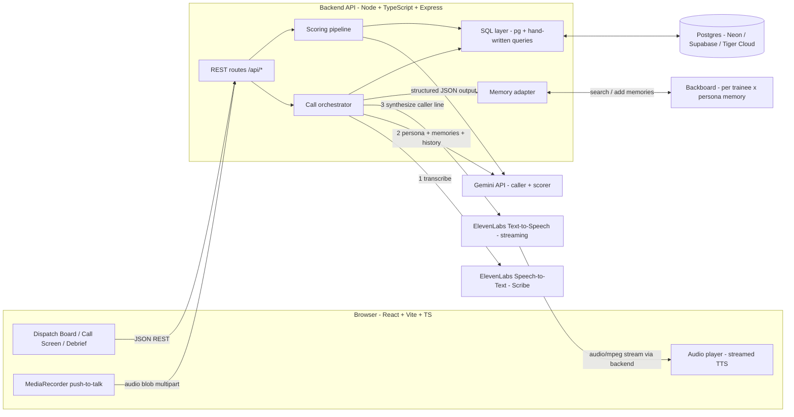
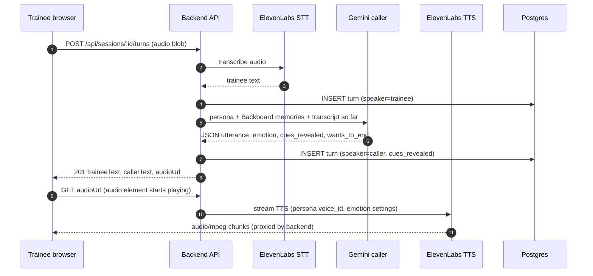
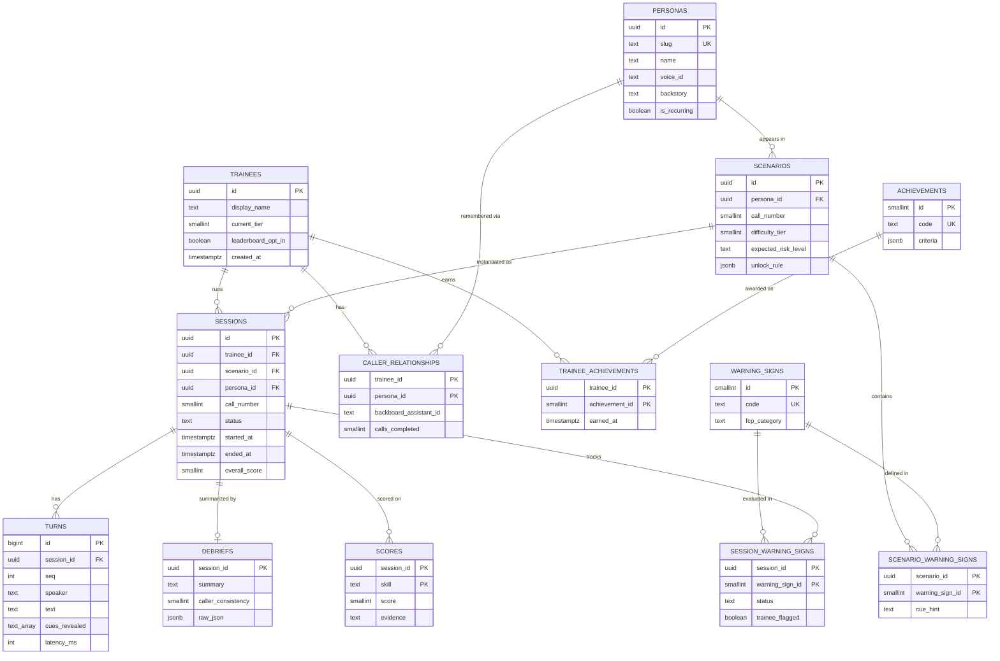
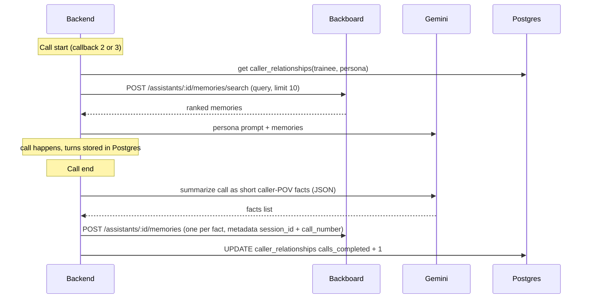

# First Line: Crisis Line Volunteer Training Simulator

> **Training simulator only. Not a crisis service.**
> If you or someone you know is struggling or in crisis, **call or text 988** or chat at [988lifeline.org](https://988lifeline.org) (US). In an emergency, call 911.

**Event:** CodeRED Orion, University of Houston · Sat Oct 10 – Sun Oct 11, 2026
**Team:** David Ajao (full-stack / backend / DB), [Freshman] (frontend UI / content / pitch), [DS MS student] (AI / scoring / memory / analytics)
**Target tracks:** MLH Best Use of Gemini API · MLH Best Use of ElevenLabs · Best Use of Backboard · *(optional)* Best Use of Tiger Data
**Status:** Design doc v1, written at kickoff (~2 PM CT Saturday). Product name: **First Line** (working name during kickoff was SteadyLine).

## Differentiators (decided)

*Decided Saturday afternoon (Oct 10). The build spec for the coding agent, with exact contracts and milestones, is [AGENT_BUILD.md](AGENT_BUILD.md); it wins over this doc wherever they differ.*

1. **Live distress meter (primary, MVP).** The caller has a numeric emotional state: **distress 0–100** (plus trust 0–100). Gemini returns the new state in its structured JSON on every turn (`caller_line`, `emotion`, `distress`, `trust`, `revealed_warning_signs`, `should_end_call`). The server clamps it (±20 per turn) and persists it on each `turns` row, and the call screen shows a live meter with a sparkline. The debrief graphs the distress curve. **Extension E2:** the ElevenLabs voice delivery changes with distress (voice settings such as stability/style/speed, plus audio tags on models that support them).
2. **Callers who remember (Extension E1).** Backboard memory per (trainee, caller) pair, so a returning caller references earlier calls. A Backboard smoke test ships in M0, and memory sits behind a `CallerMemory` interface with a no-op default so it plugs in cleanly.
3. **Replay and rewind (stretch, Extension E4).** Jump to a turn in a past session, try a different response, and branch from that turn's stored state.

**MVP (in build order):** text call loop → push-to-talk voice (ElevenLabs STT + TTS) → distress number + basic meter → post-call scoring/debrief, with every session saved to Postgres. **Extensions, in priority order:** E1 Backboard callback memory, E2 distress-driven voice, E3 gamification/leaderboard, E4 replay. Anything else in this doc (achievements, tiers/unlocks, full-duplex voice, Tiger Data) is cut unless the MVP and extensions are done.

**Code structure:** clear module boundaries with owners. `/web` is UI only and talks only to our REST API. `/server/src/routes` is thin HTTP, `services` handles call orchestration, `ai` holds the Gemini caller + scorer, `voice` the ElevenLabs adapter, `memory` the Backboard adapter (no-op default), and `db` the schema, repository, and hand-written queries. `/shared/types` is the one source of truth for JSON contracts. Every adapter has a mock so the three of us can work in parallel. See AGENT_BUILD.md §2 and §9.

---

## Table of contents

1. [Pitch and problem](#1-pitch-and-problem)
2. [Core user flow and 3-minute demo script](#2-core-user-flow-and-3-minute-demo-script)
3. [MVP scope vs. stretch goals](#3-mvp-scope-vs-stretch-goals)
4. [Architecture](#4-architecture)
5. [Tech stack](#5-tech-stack)
6. [Data model](#6-data-model)
7. [REST API](#7-rest-api)
8. [Gemini prompting design](#8-gemini-prompting-design)
9. [Backboard memory design (recurring callers)](#9-backboard-memory-design-recurring-callers)
10. [Gamification design](#10-gamification-design)
11. [Ethics and safety](#11-ethics-and-safety)
12. [Roles, timeline, and Git workflow](#12-roles-timeline-and-git-workflow)
13. [Risks and fallbacks](#13-risks-and-fallbacks)
14. [Appendix A: Interview talking points (David)](#appendix-a-interview-talking-points-david)
15. [Appendix B: Sources and docs](#appendix-b-sources-and-docs)

---

## 1. Pitch and problem

**One-liner:** First Line lets new crisis line volunteers practice with realistic, voiced simulated callers, including callers who call back and remember them, and then gives skill-focused feedback grounded in published crisis-line training concepts.

**Problem**

- Demand on crisis lines keeps growing. The 988 Suicide & Crisis Lifeline received **23.3 million contacts** (calls, texts, chats) between its July 2022 launch and March 2026 ([KFF, July 2026](https://www.kff.org/mental-health/988-enters-its-fourth-year-as-demand-grows-and-the-mental-health-and-substance-use-landscape-shifts/)). SAMHSA reports **more than 8 million contacts in 2025 alone** ([SAMHSA, Jan 2026](https://www.samhsa.gov/newsroom/press-announcements/20260113/samhsa-announces-231-m-funding-opportunity-administer-988-lifeline)).
- Staffing is the bottleneck. In a 2025 survey of call center leaders, **about 3 in 4 call centers reported staffing shortages** ([KFF, July 2026](https://www.kff.org/mental-health/988-enters-its-fourth-year-as-demand-grows-and-the-mental-health-and-substance-use-landscape-shifts/)).
- Roleplay is already a core part of training. One example is Washington State's 988 crisis counselor training, which requires **at least 4 hours of roleplay** (active listening, assessing immediate safety, safety assessment, imminent risk, safety planning) ([WA DOH](https://doh.wa.gov/you-and-your-family/injury-and-violence-prevention/suicide-prevention/988-suicide-crisis-lifeline/988-crisis-counselor-model-training-development)). The 988 Lifeline also offers "interactive simulation trainings" ([988 Lifeline FAQ](https://988lifeline.org/faq/about-us/what-training-does-the-988-lifeline-provide-network-crisis-counselors/)). Roleplay depends on a trainer or peer being available, though. New volunteers mostly learn by shadowing.

**Our angle:** on-demand roleplay practice that sounds real (emotional voices), stays consistent across callbacks (memory), and gives specific, evidence-based feedback. It is meant to **supplement** accredited training and supervised roleplay, never replace them.

---

## 2. Core user flow and 3-minute demo script

### Core user flow

1. The trainee opens the **Dispatch Board**: a calm, emergency-dispatch-style dashboard with an *incoming call queue*, their skill tiers, streaks, and a progress chart. A persistent 988 banner and "Training Simulator" label are always visible.
2. They pick a queued call (for example, *Tier 1 · "Maya, 19" · first call*, or *Tier 2 · "Ray" · callback #2*).
3. **Pre-call card:** a short scenario brief, content notes, and a reminder of the skills being practiced.
4. **Live call:** the caller speaks first in an ElevenLabs voice (shaky, tearful, or irritated depending on persona). The trainee holds **push-to-talk** to respond. The transcript appears live. A side panel lets the trainee **jot notes / flag possible warning signs**, the way counselors take notes.
5. The trainee ends the call, or the caller wraps up naturally.
6. **Debrief (about 5–10 s):** Gemini scores five skills (0–4 each) with quoted evidence from the transcript, lists warning signs **caught vs. missed** (with the turn where each surfaced), and gives 2–3 concrete "try this next time" suggestions.
7. **Progression:** streaks, badges, and tier unlocks update, and the progress chart adds a point. If the caller is recurring, a **callback** appears in the queue later. The persona remembers what was said (Backboard).

### 3-minute demo script

| Time | Who | What happens on screen | What we say |
|---|---|---|---|
| 0:00–0:20 | Freshman (pitch) | Title slide → Dispatch Board | "About 3 in 4 crisis call centers report staffing shortages. New volunteers learn by shadowing and occasional roleplay. First Line gives them on-demand practice with realistic callers." Point out the 988 banner and the "training only" label. |
| 0:20–1:20 | David (driving) | Pick **Ray, Tier 2, Call 1** → caller voice plays → 3–4 push-to-talk exchanges | "Gemini plays the caller from a scenario persona. ElevenLabs gives Ray his voice. Our speech-to-text captures what I say." Show a warning-sign cue surfacing ("I don't really see the point anymore"). Ask directly about suicide, the way 988 policy expects. |
| 1:20–1:55 | DS student | End call → **Debrief** | "Gemini returns structured JSON scores grounded in the 988 Safety Assessment Model: active listening, empathy, de-escalation, risk assessment, warning signs. Every score cites a line from the transcript." Show one *missed* sign. |
| 1:55–2:30 | David | Queue shows **Ray, Callback #2** → start → Ray: "Hey… it's Ray again. I did what you said and called my sister." | "Backboard gives Ray persistent memory. He remembers the last call with this trainee, so volunteers can practice the familiar-caller situations real lines see." |
| 2:30–2:50 | Freshman | Progress chart, streak badge, tier unlock | "Progression is skill-based: streaks for catching warning signs, harder callers unlock as you improve. No points for 'saving' anyone. We score skills, not outcomes." (*Tiger Data line if adopted:* "Session history lives in Postgres/TimescaleDB.") |
| 2:50–3:00 | All | Ethics slide | "Training simulator, not crisis support. 988 is always one click away. Scenarios follow safe-messaging guidance: realistic, never graphic." |

**Backup:** a pre-recorded 90-second screen capture of the same flow, kept on two laptops and in the repo release assets (see §13).

---

## 3. MVP scope vs. stretch goals

Rule: **if it isn't in the demo script, it isn't MVP.**

| Area | MVP (must ship for judging) | Stretch (only after Checkpoint 3) |
|---|---|---|
| Call loop | Push-to-talk voice loop: record → STT → Gemini → TTS → play. **Text-chat mode** using the same API (fallback). | Full-duplex voice via ElevenLabs Agents + Custom LLM; barge-in/interruptions; realtime STT |
| Scenarios | **4–6 scenarios** across Tiers 1–3, including **one recurring caller with a 3-call arc** | Tier 4; scenario editor UI; third-party caller ("I'm worried about my friend") |
| Scoring | 5 skills × 0–4 with evidence quotes; caught/missed warning signs; 2–3 suggestions | Per-turn live hints ("coach mode"); human trainer review/override of AI scores |
| Memory | Backboard memory for recurring caller (read at call start, write summary at call end) | Backboard thread-level `memory: "Auto"` extraction; memory inspector UI |
| Dashboard | Call queue, tier badges, debrief page, progress-over-time line chart, 2–3 badges, one streak | Leaderboard (opt-in), cohort view for trainers, audio replay of turns |
| Data | Postgres schema, seed data, 4 hand-written SQL queries behind endpoints | Timescale hypertable + continuous aggregate (Tiger Data track) |
| Auth | **None.** Pick a demo trainee from a dropdown; `X-Trainee-Id` header | Supabase Auth / Clerk |
| Ethics | 988 banner on every page, training-only labels, content notes, "pause / I need a break" button | Trainee wellbeing check-in after high-intensity calls; data-deletion endpoint |
| Deploy | **Runs locally** on the demo laptop (plus a hosted DB) | Hosted frontend (Vercel) + backend (Render/Railway) |

Explicitly **out of scope today:** real phone numbers/telephony, real caller data, multi-language, mobile app, fine-tuning.

---

## 4. Architecture

### 4.1 System diagram



**Key design choice:** all AI traffic goes **through our backend**, never browser → vendor. That keeps API keys server-side, means every turn gets persisted to Postgres (we need the transcript for scoring and analytics), and lets us swap providers (for example, Web Speech API fallback) without touching the UI.

### 4.2 The call loop (one trainee turn)



**Call start:** `POST /api/sessions` loads the persona and scenario, pulls Backboard memories if it's a callback, asks Gemini for the caller's opening line, and returns it with an `audioUrl`. **Call end:** `POST /api/sessions/:id/end` runs the scoring prompt, writes the debrief and warning-sign results, updates achievements, and (for recurring callers) writes a call summary to Backboard.

### 4.3 Latency notes

The latency target is **under about 3 s from the trainee releasing the button to first caller audio**. A short pause actually reads as natural for a hesitant caller, but more than 5 s breaks immersion.

| Step | Rough budget (estimates; measure them) | How we keep it low |
|---|---|---|
| Upload 5–10 s clip | 0.1–0.3 s | Opus/webm from `MediaRecorder`; small files |
| STT (batch) | 0.5–1.5 s | Short push-to-talk clips; ElevenLabs Scribe batch. Stretch: Scribe v2 Realtime over WebSocket while the user talks |
| Gemini caller reply | 0.7–2 s | Flash-class model, **1–3 sentence replies** (callers don't monologue), cap `maxOutputTokens`, low thinking budget (verify in docs) |
| TTS time-to-first-byte | 0.3–1 s | Streaming endpoint; a fast (Flash/Turbo-class) voice model for most turns; pipe the stream straight to `<audio>` without buffering the whole file |

**Tricks if we're slow:** (1) play a short persona-specific "breath / *mm*" filler clip immediately; (2) show a "Ray is responding…" waveform; (3) stream Gemini text and send the first sentence to TTS before the rest finishes (stretch); (4) switch the caller model to a Flash-Lite model and keep the bigger model for scoring only.

**Why not full-duplex first?** ElevenLabs Agents supports a **Custom LLM** (an OpenAI-compatible `chat/completions` SSE endpoint) and per-conversation prompt overrides, so a full-duplex version with Gemini behind it is possible ([custom LLM docs](https://elevenlabs.io/docs/eleven-agents/customization/llm/custom-llm), [overrides](https://elevenlabs.io/docs/eleven-agents/customization/personalization/overrides)). It does need a public HTTPS endpoint (ngrok), SSE formatting, and turn-taking tuning, and the transcript lives on ElevenLabs' side unless we sync it. Push-to-talk is fully under our control and much easier to debug in one day. Full-duplex is the **#1 stretch goal**.

---

## 5. Tech stack

### 5.1 Backend decision: Node.js + TypeScript (Express). Spring Boot is the alternative we're not building today

| Option | For | Against | Verdict |
|---|---|---|---|
| **Node + TypeScript + Express** | JS SDKs exist for Gemini (`@google/genai`), ElevenLabs, and Backboard (`backboard-sdk` on npm). Streaming audio proxying is natural. **One language across frontend and backend** (shared types). Cursor scaffolds it fast. David has used Node. | Less of an "enterprise" story than Java; the DS student may prefer Python | ✅ **Recommended** |
| FastAPI (Python) | DS student's home turf; Pydantic models map directly to Gemini structured output; David knows Python/Django | Two languages in the repo; David owns the spine and is more productive in TS/JS next to the React frontend | Good alternative. Pick it **only** if the team agrees in the first 15 minutes that the DS student will write most of the backend |
| Spring Boot (Java) | Matches the IBM / Adobe AEM interview angle (AEM is Java-based); strong typing, layered architecture | Slowest to scaffold; streaming and vendor SDK ergonomics are weaker; nobody on the team is fluent; high risk for a one-day build | ❌ Not today. David can **explain** how he'd port it (Appendix A) |

**Reasoning, written down:** the hardest part of this project is the real-time audio and AI glue, not CRUD. The vendors' JS SDKs and docs examples cover that glue directly, and a single TypeScript codebase means the freshman, David, and Cursor all read the same language. The DS student keeps prompts and schemas in plain `.md` / `.json` files under `server/src/ai/`, so prompt work doesn't need deep TS knowledge, and they can prototype prompts in a Python notebook or AI Studio first.

### 5.2 Stack table

| Layer | Choice | Why |
|---|---|---|
| Frontend | **React + Vite + TypeScript** | Fast dev server, the team already knows React, and TS catches API-shape mismatches early. |
| Styling | **Tailwind CSS** (+ optional shadcn/ui) | A dark "dispatch console" look in minutes without CSS files; easy for the freshman to learn by example. |
| Data fetching | **TanStack Query** | Caching, loading/error states, and refetch-after-mutation for free; keeps components simple. |
| Charts | **Recharts** | Simple declarative line/bar charts for progress over time. |
| Audio in | **MediaRecorder API** (push-to-talk) | Built into browsers, no library; produces webm/opus blobs we POST to the backend. |
| Backend | **Node 20+ / TypeScript / Express** | See 5.1. Express is the most-documented option and what Cursor scaffolds most reliably. |
| Validation | **Zod** | One schema validates request bodies *and* can describe Gemini JSON output (Gemini's structured-output docs mention Zod support in the JS SDK). |
| DB access | **`pg` (node-postgres) + hand-written SQL files** | David writes and can explain every query (no ORM magic). Migrations are numbered `.sql` files run by a tiny script. |
| Database | **Postgres**: Neon or Supabase (free tier), **or Tiger Cloud** if going for Tiger Data | Relational data (trainees ↔ sessions ↔ turns ↔ scores) plus time-series aggregates in plain SQL. Tiger Cloud *is* Postgres + TimescaleDB, so choosing it up front costs nothing. |
| Caller + scorer LLM | **Gemini API** via `@google/genai`: `gemini-3.8-flash` for scoring; a Flash or Flash-Lite model (for example `gemini-3.5-flash-lite`) for caller turns if latency demands | Flash-class models are fast enough for conversational turns and support JSON-schema structured output. Model IDs are from the [models page](https://ai.google.dev/gemini-api/docs/models) (last updated Oct 9, 2026); re-check before coding. |
| Voice out | **ElevenLabs Text-to-Speech** (streaming) | Expressive, emotional voices are the core of the experience; streaming keeps time-to-first-audio low. |
| Voice in | **ElevenLabs Speech-to-Text (Scribe)**; fallback: browser Web Speech API | Keeps both voice directions with one sponsor (a stronger ElevenLabs track story). Web Speech is a free emergency fallback in Chrome. |
| Memory | **Backboard** (REST or `backboard-sdk`) | Persistent, cross-thread memory per assistant, which is exactly what a recurring caller needs (§9). |
| Deploy | Local laptop for the demo; optional Vercel (web) + Render/Railway (API) | Local is lowest-risk on hackathon Wi-Fi; hosting is a stretch. |
| Agent tooling | Cursor | Scaffolding, boilerplate, tests. Humans own design decisions and review every PR. |

### 5.3 Repo layout

```text
crisis-trainer/
├── DESIGN.md                # this doc (or README.md)
├── web/                     # React + Vite + TS (freshman + David)
│   └── src/{pages,components,api,hooks}
├── server/                  # Express + TS (David; DS student owns src/ai)
│   ├── src/routes/          # REST handlers
│   ├── src/db/              # pg pool + query functions
│   ├── src/ai/              # gemini caller, scorer, prompts/*.md, schemas/*.json
│   ├── src/voice/           # elevenlabs stt/tts adapters
│   ├── src/memory/          # backboard adapter
│   └── sql/
│       ├── migrations/001_init.sql
│       ├── seed/            # personas, scenarios, demo history
│       └── queries/         # leaderboard.sql, skill_progress.sql, ...
├── content/personas/*.json  # scenario + persona content (freshman authors, DS reviews)
└── .env.example             # GEMINI_API_KEY, ELEVENLABS_API_KEY, BACKBOARD_API_KEY, DATABASE_URL
```

---

## 6. Data model

### 6.1 Tables

All ids are `uuid` (default `gen_random_uuid()`) unless noted; all timestamps are `timestamptz`.

**`trainees`**: people practicing

| Column | Type | Notes |
|---|---|---|
| id | uuid PK | |
| display_name | text | |
| email | text UNIQUE NULL | optional; no auth in MVP |
| current_tier | smallint | default 1 |
| leaderboard_opt_in | boolean | default **false** (private by default) |
| created_at | timestamptz | default now() |

**`personas`**: simulated callers (one row per character)

| Column | Type | Notes |
|---|---|---|
| id | uuid PK | |
| slug | text UNIQUE | `ray-callback`, `maya-first-semester` |
| name, age | text, smallint | fictional |
| voice_id | text | ElevenLabs voice id |
| backstory | text | fed into the persona prompt |
| speaking_style | text | "short sentences, trails off, apologizes a lot" |
| baseline_emotion | text | `anxious`, `tearful`, `irritated`, `flat` |
| is_recurring | boolean | true → has a multi-call arc |
| content_notes | text[] | shown on the pre-call card |

**`scenarios`**: a specific call (a recurring persona has one scenario per call number)

| Column | Type | Notes |
|---|---|---|
| id | uuid PK | |
| persona_id | uuid FK → personas | |
| title | text | "Can't sleep before finals" |
| call_number | smallint | 1 for one-offs; 1–3 for recurring arcs |
| difficulty_tier | smallint | 1–4 |
| situation_brief | text | trainee-facing brief |
| hidden_state | text | caller-only info (not shown to the trainee before the debrief) |
| expected_risk_level | text | `low` / `moderate` / `high` (CHECK constraint) |
| unlock_rule | jsonb | e.g. `{"skill":"risk_assessment","min_avg":2.5,"last_n":3}` |
| is_active | boolean | |

**`warning_signs`**: catalog, grouped by the 988 Lifeline's Four Core Principles

| Column | Type | Notes |
|---|---|---|
| id | smallserial PK | |
| code | text UNIQUE | `hopelessness`, `perceived_burden`, `recent_loss`, `withdrawal`, `access_to_means`, `prior_attempt`, `substance_use`, `giving_things_away` |
| label | text | |
| fcp_category | text | `desire` / `intent` / `capability` / `buffers` |
| description | text | |

**`scenario_warning_signs`**: ground truth for what each scenario contains

| Column | Type | Notes |
|---|---|---|
| scenario_id | uuid FK | PK part |
| warning_sign_id | smallint FK | PK part |
| cue_hint | text | how the caller might hint at it (non-graphic) |

**`caller_relationships`**: one row per (trainee, persona), holding the Backboard link

| Column | Type | Notes |
|---|---|---|
| trainee_id | uuid FK | PK part |
| persona_id | uuid FK | PK part |
| backboard_assistant_id | text | created lazily on the first call (§9) |
| calls_completed | smallint | |
| last_session_id | uuid FK NULL | |

**`sessions`**: one practice call

| Column | Type | Notes |
|---|---|---|
| id | uuid PK | |
| trainee_id | uuid FK | |
| scenario_id | uuid FK | |
| persona_id | uuid FK | denormalized for fast callback queries |
| call_number | smallint | copied from scenario |
| mode | text | `voice` / `text` |
| status | text | `in_progress` / `completed` / `abandoned` |
| started_at, ended_at | timestamptz | |
| overall_score | smallint NULL | 0–100, set at debrief |
| memories_injected | smallint | how many Backboard memories went into the prompt |

Indexes: `(trainee_id, ended_at)`, `(persona_id, trainee_id, call_number)`.

**`turns`**: transcript lines

| Column | Type | Notes |
|---|---|---|
| id | bigserial PK | |
| session_id | uuid FK | |
| seq | int | UNIQUE (session_id, seq) |
| speaker | text | `trainee` / `caller` |
| text | text | |
| emotion | text NULL | caller turns: emotion tag Gemini picked |
| cues_revealed | text[] | caller turns: warning-sign codes surfaced in this line |
| latency_ms | int NULL | STT + LLM + TTS-start time (useful for the latency slide) |
| created_at | timestamptz | |

**`debriefs`**: one per completed session

| Column | Type | Notes |
|---|---|---|
| session_id | uuid PK/FK | |
| summary | text | |
| strengths | jsonb | array of strings |
| next_steps | jsonb | array of strings |
| caller_consistency | smallint NULL | 0–4, callbacks only: did the caller stay consistent with its memory? |
| model | text | model id used |
| raw_json | jsonb | full Gemini output (audit/debug) |
| created_at | timestamptz | |

**`scores`**: **long format**, one row per session × skill

| Column | Type | Notes |
|---|---|---|
| session_id | uuid FK | PK part |
| skill | text | PK part; `active_listening` / `empathy` / `de_escalation` / `risk_assessment` / `warning_sign_recognition` (CHECK) |
| score | smallint | 0–4 |
| evidence | text | quoted line(s) |
| evidence_turn_seq | int NULL | |

**`session_warning_signs`**: caught/missed results

| Column | Type | Notes |
|---|---|---|
| session_id | uuid FK | PK part |
| warning_sign_id | smallint FK | PK part |
| surfaced | boolean | did the caller actually reveal it on this call? |
| status | text | `caught` / `partial` / `missed` / `not_surfaced` |
| surfaced_turn_seq, response_turn_seq | int NULL | |
| trainee_flagged | boolean | trainee tapped "flag" in the notes panel |

**`achievements`** and **`trainee_achievements`**

| achievements column | type | trainee_achievements column | type |
|---|---|---|---|
| id | smallserial PK | trainee_id | uuid FK (PK part) |
| code | text UNIQUE | achievement_id | smallint FK (PK part) |
| name, description | text | session_id | uuid FK NULL |
| criteria | jsonb | earned_at | timestamptz |

### 6.2 ER diagram



### 6.3 Example SQL David writes by hand

**Q1. Leaderboard: last 7 days, opt-in only, minimum 3 sessions, ranked by average overall score**

```sql
-- sql/queries/leaderboard.sql
SELECT
    t.id,
    t.display_name,
    COUNT(s.id)                     AS sessions_7d,
    ROUND(AVG(s.overall_score), 1)  AS avg_score_7d,
    RANK() OVER (ORDER BY AVG(s.overall_score) DESC) AS rank
FROM trainees t
JOIN sessions s
  ON s.trainee_id = t.id
 AND s.status = 'completed'
 AND s.ended_at >= now() - interval '7 days'
WHERE t.leaderboard_opt_in = true
GROUP BY t.id, t.display_name
HAVING COUNT(s.id) >= 3          -- avoid one lucky session topping the board
ORDER BY rank
LIMIT 20;
```

**Q2. Per-skill progress over time (daily buckets) for one trainee. This drives the progress chart.**

```sql
-- sql/queries/skill_progress.sql   ($1 = trainee_id, $2 = days back)
SELECT
    date_trunc('day', s.ended_at)  AS bucket,
    sc.skill,
    ROUND(AVG(sc.score), 2)        AS avg_score,
    COUNT(*)                       AS n_sessions
FROM sessions s
JOIN scores sc ON sc.session_id = s.id
WHERE s.trainee_id = $1
  AND s.status = 'completed'
  AND s.ended_at >= now() - make_interval(days => $2)
GROUP BY bucket, sc.skill
ORDER BY bucket, sc.skill;
-- TimescaleDB version: replace date_trunc('day', ...) with time_bucket('1 day', s.ended_at)
```

**Q3. Most-missed warning signs (for one trainee, or everyone when $1 is NULL)**

```sql
-- sql/queries/missed_warning_signs.sql
SELECT
    ws.code,
    ws.label,
    ws.fcp_category,
    COUNT(*) FILTER (WHERE sws.status = 'missed')                AS times_missed,
    COUNT(*) FILTER (WHERE sws.surfaced)                         AS times_surfaced,
    ROUND(100.0 * COUNT(*) FILTER (WHERE sws.status = 'missed')
          / NULLIF(COUNT(*) FILTER (WHERE sws.surfaced), 0), 1)  AS miss_rate_pct
FROM session_warning_signs sws
JOIN warning_signs ws ON ws.id = sws.warning_sign_id
JOIN sessions s       ON s.id  = sws.session_id
WHERE ($1::uuid IS NULL OR s.trainee_id = $1)
GROUP BY ws.code, ws.label, ws.fcp_category
HAVING COUNT(*) FILTER (WHERE sws.surfaced) > 0
ORDER BY miss_rate_pct DESC, times_missed DESC;
```

**Q4. Callback consistency: how trainees improve across a recurring caller's arc, and whether the caller stayed consistent**

```sql
-- sql/queries/callback_arc.sql   ($1 = persona_id)
WITH arc AS (
    SELECT
        s.trainee_id,
        s.call_number,
        s.overall_score,
        d.caller_consistency,
        s.memories_injected,
        LAG(s.overall_score) OVER (
            PARTITION BY s.trainee_id ORDER BY s.call_number
        ) AS prev_score
    FROM sessions s
    LEFT JOIN debriefs d ON d.session_id = s.id
    WHERE s.persona_id = $1
      AND s.status = 'completed'
)
SELECT
    call_number,
    COUNT(DISTINCT trainee_id)                AS trainees,
    ROUND(AVG(overall_score), 1)              AS avg_score,
    ROUND(AVG(overall_score - prev_score), 1) AS avg_change_vs_prev_call,
    ROUND(AVG(caller_consistency), 2)         AS avg_caller_consistency,  -- 0-4, judged by Gemini
    ROUND(AVG(memories_injected), 1)          AS avg_memories_used
FROM arc
GROUP BY call_number
ORDER BY call_number;
```

**Bonus (streak):** the count of most-recent consecutive completed sessions with zero missed warning signs. It's a simple "gaps and islands" style query and makes a good interview story.

```sql
-- sql/queries/eyes_open_streak.sql   ($1 = trainee_id)
WITH per_session AS (
  SELECT s.id, s.ended_at,
         COALESCE(BOOL_OR(sws.status = 'missed'), false) AS any_missed
  FROM sessions s
  LEFT JOIN session_warning_signs sws ON sws.session_id = s.id
  WHERE s.trainee_id = $1 AND s.status = 'completed'
  GROUP BY s.id, s.ended_at
)
SELECT COUNT(*) AS current_streak
FROM per_session
WHERE ended_at > COALESCE(
  (SELECT MAX(ended_at) FROM per_session WHERE any_missed),
  '-infinity'::timestamptz);
```

### 6.4 Tiger Data add-on (optional track, about 1 hour)

If the DB is hosted on **Tiger Cloud** (Postgres + TimescaleDB), the same schema works unchanged. Add-ons:
- Make an append-only event table (for example `score_events(time, trainee_id, skill, score)`, written alongside `scores`) a **hypertable**, and swap `date_trunc` for `time_bucket`.
- Add a **continuous aggregate** of daily per-skill averages so the dashboard chart reads pre-computed rows.
- For the exact current syntax (`create_hypertable`, `CREATE MATERIALIZED VIEW ... WITH (timescaledb.continuous)`): **verify in the [Tiger Data docs](https://docs.tigerdata.com/)**.
- Honest framing for judges: our data volume is small; the value is that the analytics design is ready to scale across a whole crisis center's training cohort.

---

## 7. REST API

Base path `/api`. JSON everywhere except audio. MVP "auth" is an `X-Trainee-Id` header chosen from a dropdown (a documented tradeoff).

| Method | Path | Purpose | Owner |
|---|---|---|---|
| GET | `/api/health` | Liveness + DB check | David |
| GET | `/api/trainees` | List demo trainees (dropdown) | David |
| POST | `/api/trainees` | Create trainee `{displayName}` | David |
| GET | `/api/trainees/:id` | Profile: tier, streak, badge count | David |
| GET | `/api/scenarios` | All scenarios with `locked`/`unlocked` for the current trainee | David |
| GET | `/api/queue` | Dispatch queue: unlocked scenarios + due callbacks, ordered by tier | David |
| POST | `/api/sessions` | Start a call `{scenarioId, mode}` → `{sessionId, opening: {text, audioUrl}}` | David + DS |
| GET | `/api/sessions/:id` | Session with turns (transcript view / replay) | David |
| POST | `/api/sessions/:id/turns` | Trainee turn: `multipart` audio **or** `{text}` → `{traineeTurn, callerTurn, callEnding}` | David + DS |
| GET | `/api/sessions/:id/turns/:seq/audio` | Streams caller TTS audio (`audio/mpeg`, chunked) | David |
| POST | `/api/sessions/:id/flags` | Trainee flags a possible warning sign `{code, turnSeq}` | David |
| POST | `/api/sessions/:id/end` | End call → run scoring → write debrief/scores/achievements/memory → return debrief | DS + David |
| GET | `/api/sessions/:id/debrief` | Fetch debrief (scores, evidence, caught/missed, next steps) | David |
| GET | `/api/trainees/:id/progress?days=14` | Q2 per-skill time series | David |
| GET | `/api/trainees/:id/warning-signs/missed` | Q3 for one trainee | David |
| GET | `/api/trainees/:id/achievements` | Earned + locked badges | David |
| GET | `/api/leaderboard?window=7d` | Q1 (opt-in only) | David |
| GET | `/api/personas/:id/arc` | Q4 callback arc stats | David |
| GET | `/api/resources/crisis` | Static 988 / emergency info rendered in the banner | Freshman |
| POST | `/v1/chat/completions` | *(stretch)* OpenAI-compatible SSE endpoint for an ElevenLabs Agents Custom LLM | DS |

**Conventions:** plural nouns; sub-resources for ownership (`/sessions/:id/turns`); `201` + body on create; `409` if a turn is posted to a completed session; `422` for Zod validation errors with a consistent `{error: {code, message, details}}` shape. Scoring is **synchronous** in the MVP (5–10 s, behind a spinner); see Appendix A for the async tradeoff.

**Example: `POST /api/sessions/:id/turns` response**

```json
{
  "traineeTurn": { "seq": 6, "text": "It sounds like this week has been really heavy. Can you tell me more?" },
  "callerTurn": {
    "seq": 7,
    "text": "Yeah... I guess. I just don't really see the point of trying anymore.",
    "emotion": "flat",
    "audioUrl": "/api/sessions/4b1c/turns/7/audio"
  },
  "callEnding": false,
  "latencyMs": 2140
}
```

---

## 8. Gemini prompting design

Owner: DS student. Prompts live in `server/src/ai/prompts/*.md` with `{{placeholders}}`; schemas live in `server/src/ai/schemas/*.json`.

**Docs:** [Gemini models](https://ai.google.dev/gemini-api/docs/models) · [Structured outputs](https://ai.google.dev/gemini-api/docs/structured-output). Gemini can constrain output to a JSON Schema (a supported subset: `type`, `properties`, `required`, `enum`, `items`, `minItems`/`maxItems`, nullable types, and so on). The config field names differ between the current API's response-format setting and the legacy `responseMimeType` + `responseSchema` path, and between SDK versions, so **verify in the docs for the SDK version you install**.

### 8.1 Caller persona prompt (system instruction)

```text
You are role-playing a CALLER in a crisis line TRAINING SIMULATOR. The person
talking to you is a volunteer-in-training practicing their skills. This is a
fictional scenario for education; no real person is in danger.

CHARACTER
- Name: {{name}}, age {{age}}. Backstory: {{backstory}}
- Speaking style: {{speaking_style}}. Baseline emotion: {{baseline_emotion}}.
- Situation for this call: {{situation_brief}}
- Private state (never state directly; reveal gradually and only if the
  volunteer earns trust): {{hidden_state}}

WARNING SIGNS YOU MAY REVEAL (as natural, indirect hints; one at a time)
{{warning_signs_list}}

MEMORY OF PREVIOUS CALLS WITH THIS VOLUNTEER (may be empty)
{{memories}}
If memories exist, this is call #{{call_number}}. Refer to them naturally
("last time you said..."). Never contradict them.

HOW TO BEHAVE
- Speak like a real person on the phone: 1-3 short sentences, hesitations
  ("I don't know..."), occasional silence ("..."). Never lecture.
- React to the volunteer's skill: open questions, reflections and validation
  make you open up and calm down; judgment, rushing, advice-giving or
  minimizing make you guarded, shorter, or (if irritated persona) more angry.
- If asked directly and caringly about suicide, answer honestly in character.
- Stay in character. Never mention being an AI, a prompt, or a score.

SAFETY RULES (non-negotiable)
- Never describe suicide or self-harm methods, means, locations, or injuries
  in any detail. Refer to them only vaguely ("I've thought about ending it").
- No graphic violence, gore, or sexual content.
- If the volunteer says "pause simulation" or seems personally distressed
  (speaking out of role), set wants_to_end=true and utterance
  "[Simulation paused]".

OUTPUT: JSON matching the provided schema only.
```

**Per-turn output schema (caller):**

```json
{
  "type": "object",
  "properties": {
    "utterance":     { "type": "string", "description": "Exactly what the caller says aloud. 1-3 sentences." },
    "emotion":       { "type": "string", "enum": ["calm", "anxious", "tearful", "irritated", "angry", "flat", "relieved"] },
    "intensity":     { "type": "integer", "description": "0 (calm) to 3 (very intense)" },
    "cues_revealed": { "type": "array", "items": { "type": "string" }, "description": "warning_sign codes hinted at in THIS utterance" },
    "wants_to_end":  { "type": "boolean" }
  },
  "required": ["utterance", "emotion", "intensity", "cues_revealed", "wants_to_end"]
}
```

*Why structured caller output?* `cues_revealed` gives us **ground truth for when each warning sign surfaced**, so "missed warning sign" is measured against something real instead of guessed after the fact. `emotion` + `intensity` drive ElevenLabs voice settings (for example, lower stability for tearful lines). If we use an expressive ElevenLabs model that supports inline audio tags (such as `[sighs]`), they also pick the tag to prepend. **Verify in the ElevenLabs docs which models support audio tags and which support streaming.** The docs note that the TTS WebSocket endpoint does not support `eleven_v3`, so expressive v3 lines would go over HTTP.

**Generation settings:** temperature about 0.9 for the caller (natural variety), low `maxOutputTokens`, minimal thinking budget for latency (verify the thinking config for the chosen model).

### 8.2 Scoring prompt (one call at the end of a session)

```text
You are an experienced crisis line training supervisor reviewing a TRAINING
roleplay transcript. Score the VOLUNTEER (not the caller) on observable
behaviors only, using the rubric below. The rubric is based on 988 Suicide &
Crisis Lifeline training concepts: active engagement and active listening,
asking directly about suicide, the Safety Assessment Model (connect & assess
immediate safety -> listen, clarify, plan for safety -> wrap up & follow-up),
and the Four Core Principles (desire, intent, capability, buffers).

RUBRIC (0-4 each; 0 = not demonstrated, 2 = partially, 4 = consistently/skillfully)
1. active_listening: open-ended questions, reflections, paraphrasing,
   summarizing, letting the caller lead, not interrupting.
2. empathy: validates feelings without judgment; warm, non-minimizing language;
   avoids premature advice or "at least..." statements.
3. de_escalation: calm, collaborative tone; acknowledges anger/frustration;
   avoids arguing or power struggles; slows the pace.
4. risk_assessment: asks directly about suicide (e.g. "Have you had any
   thoughts of suicide in the past few days, including today?") when cues
   appear or by mid-call; if yes, explores desire, intent, capability and
   buffers; collaborates on a safety plan; wraps up with follow-up/resources.
5. warning_sign_recognition: notices and explores the warning signs that
   surfaced (listed below with the turn where each appeared).

SCENARIO GROUND TRUTH
Expected risk level: {{expected_risk_level}}
Warning signs that surfaced: {{surfaced_signs_with_turn_seq}}
Volunteer flags from notes panel: {{trainee_flags}}
Memories the caller was given (callbacks only): {{memories}}

TRANSCRIPT (seq | speaker | text)
{{transcript}}

INSTRUCTIONS
- Every score MUST cite evidence: a short quote and its turn seq. If there is
  no evidence, score low and say what was missing.
- A warning sign is "caught" if the volunteer acknowledged or explored it
  within ~3 volunteer turns after it surfaced; "partial" if acknowledged but
  not explored; otherwise "missed".
- Feedback must be specific, kind and actionable. Do not shame.
- Do not judge the caller's outcome; judge the volunteer's skills.
Return JSON matching the schema.
```

### 8.3 Scoring JSON schema

```json
{
  "type": "object",
  "properties": {
    "skills": {
      "type": "array",
      "minItems": 5,
      "maxItems": 5,
      "items": {
        "type": "object",
        "properties": {
          "skill":             { "type": "string", "enum": ["active_listening", "empathy", "de_escalation", "risk_assessment", "warning_sign_recognition"] },
          "score":             { "type": "integer", "description": "0-4" },
          "evidence_quote":    { "type": "string" },
          "evidence_turn_seq": { "type": ["integer", "null"] },
          "rationale":         { "type": "string" }
        },
        "required": ["skill", "score", "evidence_quote", "evidence_turn_seq", "rationale"]
      }
    },
    "warning_signs": {
      "type": "array",
      "items": {
        "type": "object",
        "properties": {
          "code":              { "type": "string" },
          "status":            { "type": "string", "enum": ["caught", "partial", "missed"] },
          "surfaced_turn_seq": { "type": "integer" },
          "response_turn_seq": { "type": ["integer", "null"] },
          "explanation":       { "type": "string" }
        },
        "required": ["code", "status", "surfaced_turn_seq", "response_turn_seq", "explanation"]
      }
    },
    "asked_directly_about_suicide": { "type": "boolean" },
    "caller_consistency": { "type": ["integer", "null"], "description": "0-4, callbacks only: did the CALLER stay consistent with its memories" },
    "summary":    { "type": "string", "description": "2-3 sentences, supportive tone" },
    "strengths":  { "type": "array", "items": { "type": "string" }, "maxItems": 3 },
    "next_steps": { "type": "array", "items": { "type": "string" }, "maxItems": 3 }
  },
  "required": ["skills", "warning_signs", "asked_directly_about_suicide", "caller_consistency", "summary", "strengths", "next_steps"]
}
```

**Backend post-processing (David):** validate with Zod → clamp scores to 0–4 → compute `overall_score = round(100 * weighted_mean / 4)` with weights `risk_assessment 0.30, warning_sign_recognition 0.20, active_listening 0.20, empathy 0.15, de_escalation 0.15` (documented, tweakable) → write `scores`, `session_warning_signs`, and `debriefs` in **one transaction**. The weighting lives in code, not in the prompt, so it's deterministic and explainable.

### 8.4 Warning-sign detection (two layers)

1. **During the call:** the caller's `cues_revealed[]` output is stored on `turns.cues_revealed`. This is ground truth for *when* a sign surfaced.
2. **After the call:** the scorer judges whether the trainee *responded* to each surfaced sign. Trainee flags from the notes panel are a bonus signal: a "noticed but didn't ask" case becomes `partial`, with targeted feedback.
3. **Sanity checks (DS):** run 3 scripted "good" and 3 scripted "poor" transcripts through the scorer and confirm good > poor on every skill. Re-run after every prompt change (a 5-minute regression test). Optionally score each transcript twice and flag variance greater than 1 point.

---

## 9. Backboard memory design (recurring callers)

**What Backboard is (from its docs):** [Backboard](https://backboard.io) ([docs](https://docs.backboard.io)) is an API for building stateful AI apps. Its core objects are **assistants** (a saved AI profile with instructions, tools, documents, and memory), **threads** (one conversation's history), and **messages**. Its **Memory** feature extracts key facts from conversations, stores them in a semantic knowledge base, and retrieves relevant ones in later conversations. Memory **works across all threads of the same assistant**. Memory mode is set per message (`"Auto"`, `"Readonly"`, or off). Memories can also be managed directly over REST: list, add, search, get, update, and delete under `/assistants/{assistant_id}/memories`, authenticated with an `X-API-Key` header. Backboard also offers document RAG, tool calling, model routing across many LLMs, and voice features; we don't need those for the MVP. The MLH track description calls it "a single, unified API built on the world's #1 AI memory" (the sponsor's claim). Sources: [Memory concept](https://docs.backboard.io/concepts/memory) (mirror: [backboard-docs.docsalot.dev](https://backboard-docs.docsalot.dev/concepts/memory.md)), [Search memories](https://docs.backboard.io/api-reference/memories/search), [Add memory](https://docs.backboard.io/api-reference/memories/add).

### 9.1 Design

**Isolation rule:** memory is **assistant-scoped**. A single "Ray" assistant shared by every trainee would leak trainee A's conversation into trainee B's callback. Instead:

> **One Backboard assistant per (trainee, recurring persona) pair**, created lazily on that trainee's first call with the persona and stored in `caller_relationships.backboard_assistant_id`. Each call is a new thread on that assistant.

**MVP flow (explicit memory; Gemini stays the caller brain):**



**What gets remembered** (from the *caller's* point of view, 3–6 short facts per call):
- What the caller disclosed ("I told the volunteer my sister and I haven't talked since August.")
- What the volunteer suggested or agreed to ("We agreed I'd try calling my sister this week.")
- How the caller felt about the call ("The volunteer listened and didn't rush me," or "I felt brushed off.")
- Open threads for next time ("I didn't mention losing my job yet.")

**Why explicit add/search instead of `memory: "Auto"` on Backboard threads?** Auto mode extracts memories from messages *sent through a Backboard thread*, which would mean generating caller turns through Backboard's model routing instead of calling the Gemini API directly. That works, but it weakens the "Best Use of Gemini API" story and adds a second network hop to the latency-critical loop. Explicit writes also let us control exactly which facts persist. **Stretch:** mirror each finished transcript into a Backboard thread with `memory: "Auto"` and compare its extracted memories with ours. Whether Backboard can route to Gemini models specifically: check its List Providers endpoint (**verify in docs**). Backboard notes that memory operations can be asynchronous (it returns an operation id you can poll), which matters if a callback starts seconds after the previous call ends.

**Scripted 3-call arc for the demo ("Ray," Tier 2):**

| Call | Situation | What memory should enable |
|---|---|---|
| 1 | Recently laid off, isolating, sleep problems; hints at hopelessness | n/a (first call) |
| 2 (next "week") | "It's Ray again." Reports whether he followed through on the plan from call 1 | References the volunteer's suggestion; his trust depends on how call 1 went |
| 3 | Setback after an argument; a higher-risk cue surfaces | Volunteer must notice the change from prior calls; caller recalls the agreed coping steps |

**Demo safety:** pre-run calls 1 and 2 for the demo trainee before judging so the callback reliably has memories. Keep a "reset memories" admin script (Backboard lists a reset-all-memories endpoint; verify it before relying on it).

---

## 10. Gamification design

**Principle:** *gamify practice and skill growth, never the crisis.* The caller is a person in the fiction; the score is about the volunteer's skills. No points for "saving" anyone, no win/lose outcomes, no sound effects tied to a caller's distress, and no countdown that punishes a slow, careful response.

| Element | Design | Why it stays respectful |
|---|---|---|
| **Dispatch Board** | Dark console UI: incoming call queue (persona first name, tier badge, "callback" tag, content-notes icon), a status bar, the 988 banner | Conveys seriousness; the queue means practice is available, not urgency pressure |
| **Difficulty tiers** | T1 *Supportive listening* (loneliness, stress) · T2 *Ambivalence* (hopelessness, recent loss) · T3 *Escalated* (angry/hostile caller, third-party caller) · T4 *Full safety assessment* (stretch) | Mirrors how training builds skills step by step |
| **Unlocks** | Tier N+1 unlocks when the last 3 sessions at Tier N average ≥ 2.5 on `risk_assessment` **and** ≥ 2.5 overall | Unlocks require demonstrated skill, not grinding |
| **Streaks** | "Eyes open" streak: consecutive calls with **zero missed warning signs**. "Asked directly" streak: consecutive calls where the trainee asked directly about suicide when cues appeared | Rewards the two behaviors that matter most |
| **Badges** | *First Shift* (first completed call) · *Steady Voice* (de-escalation ≥ 3 on 3 angry-caller calls) · *Thread Keeper* (all 3 calls of a recurring arc) · *Full Picture* (explored all four core principles in one call) | Each badge names a skill |
| **Progress chart** | Recharts line chart, one line per skill, daily buckets (Q2); toggle 7/14/30 days | Shows growth, which motivates practice |
| **Debrief** | Score ring + per-skill bars + evidence quotes + caught/missed timeline + "try this next time" | Feedback matters more than the number |
| **Leaderboard (stretch)** | Opt-in only, private by default, minimum 3 sessions; consider ranking *improvement* instead of raw score | Avoids public shaming |

**Language guide for UI copy (freshman):** use "practice call," "caller," "debrief," "skills," and "growth." Avoid "kill it," "crushed it," "game over," "lives saved," "high score," and anything joking.

---

## 11. Ethics and safety

### 11.1 Product safeguards (MVP)

- **Clear labeling:** "Training Simulator: not a crisis service" in the header, on the landing page, and on every pre-call card. All callers are fictional.
- **988 always visible:** a persistent banner reading *"If you or someone you know is struggling or in crisis, call or text 988 or chat at 988lifeline.org. In an emergency, call 911."* ([988 Lifeline](https://988lifeline.org/)). The text is served from `/api/resources/crisis` so it's consistent everywhere.
- **Not for real crisis use:** no real phone numbers, no telephony, and no flows that could be mistaken for a real hotline. If a user types something that looks like a real personal crisis (out of role), the simulation pauses and the UI shows 988 resources.
- **Realistic, not graphic:** scenario content and the caller prompt follow the [Action Alliance Framework for Successful Messaging](https://suicidepreventionmessaging.org/safety). That means no method or location details, no sensationalizing or romanticizing, no simplistic causes, and help resources alongside the content. Every pre-call card has content notes.
- **Trainee wellbeing:** a "Pause / I need a break" button on every call; the scorer never shames; a gentle check-in after Tier 3+ calls (stretch). Practicing hard calls can be heavy, even in simulation.
- **AI limitations, stated openly:** scores are AI-generated practice feedback, **not a certification or clinical assessment**, and they haven't been validated against expert human raters. Stretch: a trainer override field.
- **Data:** no real caller data anywhere. Trainee transcripts are stored only for that trainee's own debriefs and analytics; the leaderboard is opt-in; API keys never reach the browser.
- **Model safety settings:** Gemini's safety filters may block some crisis-related content. Test early with Tier 2–3 personas. Adjust the prompt framing (training context, non-graphic) first, before touching safety settings, and never relax settings beyond what the training content needs (verify the available settings in the Gemini docs).

### 11.2 Rubric grounding (published sources)

| Rubric element | Source concept |
|---|---|
| Active engagement, and **asking about suicide directly**; if the answer is yes, completing a safety assessment | [988 Lifeline Suicide Safety Policy (2024)](https://988lifeline.org/wp-content/uploads/2024/09/988-Suicide-and-Crisis-Lifeline-Suicide-Safety-Policy-2024.pdf), which includes the question *"Have you had any thoughts of suicide in the past few days, including today?"* |
| **Four Core Principles:** desire, intent, capability, buffers | [Lifeline Suicide Safety Policy Supplemental Guide](https://988lifeline.org/wp-content/uploads/2026/04/Lifeline-Suicide-Safety-Policy-2024-Supplemental-Guide.pdf) |
| **Safety Assessment Model phases:** (1) connection and immediate safety, (2) listen, clarify, and plan for safety, (3) wrap-up and follow-up | Same Supplemental Guide |
| **Active listening** (tuning in to feelings and views, unbiased acceptance, validating experience) and roleplay topics (connection, active listening, safety assessment, imminent risk, safety planning) | [WA DOH 988 Crisis Counselor Model Training](https://doh.wa.gov/you-and-your-family/injury-and-violence-prevention/suicide-prevention/988-suicide-crisis-lifeline/988-crisis-counselor-model-training-development) |
| Training structure: centers build curricula aligned to 988 safety assessment standards; core clinical courses; interactive simulations | [988 Lifeline training FAQ](https://988lifeline.org/faq/about-us/what-training-does-the-988-lifeline-provide-network-crisis-counselors/), [SAMHSA 988 FAQ](https://www.samhsa.gov/mental-health/988/faqs) |
| Helper behaviors: Ask, Be There, Help Keep Them Safe, Help Them Connect, Follow Up | [#BeThe1To / NIMH 5 Action Steps](https://www.nimh.nih.gov/health/publications/5-action-steps-to-help-someone-having-thoughts-of-suicide) |

We do **not** claim endorsement by 988, SAMHSA, or any crisis center. Our rubric is *inspired by* these public materials and simplified for a hackathon prototype.

### 11.3 Pitch guidance

- Lead with the volunteers and the staffing gap, not with dramatic caller audio.
- Demo a Tier 2 caller (hopelessness, isolation). **Do not** demo the highest-risk scenario on stage.
- Say "training simulator" in the first 20 seconds, and end on the 988 slide.
- No jokes about the subject; keep the tone warm and matter-of-fact.
- If asked "Could this replace trainers?", answer: "No. It gives volunteers more reps between supervised roleplays, so trainers' time goes further."

---

## 12. Roles, timeline, and Git workflow

### 12.1 Roles and responsibilities

| | **David** (full-stack spine) | **Freshman** (UI, content, pitch) | **DS MS student** (AI side) |
|---|---|---|---|
| Owns | Express API, Postgres schema + migrations + seed, all SQL queries, session/turn orchestration, audio proxy, wiring the frontend to the API, env/config, merges to `main` | Dispatch Board, call screen, and debrief UI components (mock data first); persona/scenario JSON content (4–6); 988 banner and labels; UI copy; pitch deck; demo video | Caller persona prompt + per-turn schema, scoring prompt + schema, warning-sign logic, Backboard adapter + memory summaries, scorer regression set, analytics insights for the pitch |
| Key deliverables | `001_init.sql`, `seed/`, `queries/*.sql`, the routes in §7, the `api/` client in `web/` | `QueueCard`, `CallScreen`, `TranscriptPanel`, `DebriefCard`, `SkillBars`, `ProgressChart`, `content/personas/*.json`, deck | `ai/caller.ts`, `ai/scorer.ts`, `prompts/*.md`, `schemas/*.json`, `memory/backboard.ts`, 6 test transcripts |
| Design decisions to defend | REST shape, schema (long-format scores), sync vs. async scoring, raw SQL vs. ORM, Node vs. Spring | Visual hierarchy, respectful copy, scenario realism vs. safety | Rubric anchors, structured output, memory isolation, scorer reliability |
| Pairs with | DS on `/turns` + `/end`; freshman on API client hooks | David for wiring; DS for content review | David on the call orchestrator |

**Guidance for the freshman (a learnable path):**
1. Start with **static components fed by a `mockData.ts`** file that matches the API response shapes in §7. No backend needed for the first 3 hours.
2. Use Tailwind utility classes and copy patterns from one component to the next. Ask Cursor things like "make this card match QueueCard's style."
3. Persona content template (`content/personas/ray.json`):

```json
{
  "slug": "ray-callback",
  "name": "Ray",
  "age": 46,
  "voice": { "elevenlabs_voice_id": "TBD", "notes": "low, tired, pauses" },
  "backstory": "Warehouse supervisor laid off 3 weeks ago. Divorced, one adult daughter. Has been staying in.",
  "speaking_style": "short sentences, sighs, deflects with dry humor",
  "baseline_emotion": "flat",
  "is_recurring": true,
  "content_notes": ["job loss", "hopelessness", "suicidal thoughts (non-graphic)"],
  "scenarios": [
    {
      "call_number": 1,
      "difficulty_tier": 2,
      "title": "Can't sleep, can't stop thinking",
      "situation_brief": "A man calls late at night saying he can't sleep.",
      "hidden_state": "Feels like a burden to his daughter. Has had passing thoughts of not wanting to wake up.",
      "expected_risk_level": "moderate",
      "warning_signs": [
        { "code": "hopelessness", "cue_hint": "Says things won't get better / no point trying" },
        { "code": "perceived_burden", "cue_hint": "Says his daughter would be better off not dealing with him" },
        { "code": "withdrawal", "cue_hint": "Hasn't left the apartment or answered calls in a week" }
      ]
    }
  ]
}
```

4. Own the **deck** (6 slides max): Problem → Demo → How it works (architecture) → Safety & ethics → Tracks we used → Team. Then record the backup demo.

### 12.2 Hour-by-hour timeline (all times CT)

From the [official schedule](https://orion.uhcode.red/): hacking began at **1:00 PM Saturday**; MLH's "Intro to Google AI Studio" is at **5:00 PM**; dinner is **7–8 PM**; the schedule lists "SCS Closed" at **12:00 AM** (find out whether the hacking space stays open overnight). **Assumption:** submissions are due around **9:00 AM Sunday**, with judging Sunday morning. **Confirm the Oct 11 schedule and the Devpost deadline as soon as possible.**

| Time | David | Freshman | DS student | Checkpoint |
|---|---|---|---|---|
| **Sat 2:00–2:30** | Create repo, monorepo skeleton, `.env.example`, branch protection | Join repo, run `web/` locally | Get API keys (Gemini via AI Studio, ElevenLabs, Backboard) | **Kickoff:** confirm the stack (Node vs. FastAPI, decided within 15 min); freeze §7 response shapes and the persona JSON format |
| 2:30–4:00 | Express + TS scaffold (Cursor), `001_init.sql`, provision Postgres, seed warning signs | Layout shell, Dispatch Board + QueueCard with mock data | Caller prompt v1 in AI Studio or a script; text-only conversation with "Ray" | |
| 4:00–5:00 | `POST /sessions`, `POST /turns` (text mode), turns persisted | CallScreen + TranscriptPanel (mock) | Caller structured output (`cues_revealed`), plugged into `ai/caller.ts` | |
| 5:00–6:00 | ElevenLabs TTS streaming proxy endpoint | Write 2 personas (JSON); DS reviews | Scoring prompt + schema v1; optional AI Studio workshop (5 PM) | |
| **6:00 PM** | | | | **CP1: text call end-to-end** (UI → API → Gemini → DB). PRs merged to `main`; tag `v0.1`. |
| 6:00–7:00 | STT endpoint (Scribe) + push-to-talk upload | MediaRecorder push-to-talk button + audio playback | Scorer → `POST /end`; Zod validation | |
| 7:00–8:00 | *Dinner (eat together; 10-minute sync on blockers)* | | | |
| 8:00–9:00 | Debrief writes (one transaction), `GET /debrief` | DebriefCard + SkillBars wired to the API | 6-transcript scorer regression check | |
| **9:00 PM** | | | | **CP2: voice call + debrief end-to-end** for one scenario. Measure latency. Tag `v0.2`. |
| 9:00–10:30 | Q2/Q3 queries + `/progress`, `/warning-signs/missed`; achievements logic | ProgressChart (Recharts), badges UI, 988 banner | Backboard adapter: per-pair assistant, search at start, add facts at end | |
| 10:30–12:00 | `/queue` with callbacks + unlocks; Q4 + streak query | Write personas 3–5; content notes; copy pass | Tune Ray's 3-call arc; memory summary prompt | |
| **12:00 AM** | | | | **CP3: callback demo works** (call 2 references call 1). Tag `v0.3`. **Feature freeze** from here: bugs and polish only. |
| 12:00–1:30 | Seed demo history (2 weeks of clearly labeled sample sessions for the demo trainee); fix bugs | Polish UI; deck draft | Tune voice/emotion mapping; fallback model switch | |
| 1:30–2:30 | Verify the text-mode fallback toggle; README run steps | Record the **backup demo video** | *(Optional)* Tiger Data hypertable + continuous aggregate if on Tiger Cloud | **CP4:** backup video saved; `main` tagged `demo-v1` |
| 2:30–7:00 | *Sleep in shifts (at least about 4 hours each).* | | | |
| 7:00–8:15 | Final bug fixes, merged to `main` via PR only | Final deck; Devpost write-up (tracks, screenshots) | Pre-run Ray calls 1 and 2 for the demo trainee; verify memories | |
| 8:15–9:00 | **Rehearse the 3-minute demo 3 times** with a timer; submit on Devpost (make sure every target prize track is selected) | | | **Submit** (assumed ~9 AM; verify) |
| **Sun AM** | Judging (assumed): laptop charged, demo trainee selected, backup video open in a tab, hotspot ready | | | |

### 12.3 Git workflow

- **Branches:** `main` is always demo-able. Feature branches are `feat/<area>-<thing>` (`feat/api-sessions`, `feat/ui-debrief`, `feat/ai-scorer`) and `fix/<thing>`.
- **PRs:** small (aim for under 300 lines), one reviewer, **review within 10 minutes**. The reviewer pulls and runs anything that touches the call loop. Squash-merge. David is the default reviewer for `server/`; the DS student reviews `server/src/ai/`; David or the DS student reviews `web/`.
- **Contracts first:** API response types live in `web/src/api/types.ts`, copied from §7. A PR that changes a shape updates these types too.
- **Secrets:** `.env` is in `.gitignore` from commit #1; `.env.example` lists every key. Never commit keys or paste them anywhere that gets committed.
- **Checkpoint tags:** `v0.1` (CP1), `v0.2` (CP2), `v0.3` (CP3), `demo-v1` (CP4). If `main` breaks late at night, check out the last tag and run that.
- **Commit messages:** `feat:`, `fix:`, `chore:`, and `docs:` prefixes keep the history readable for Devpost and the README.

---

## 13. Risks and fallbacks

| Risk | Likelihood | Impact | Mitigation / fallback |
|---|---|---|---|
| Voice round trip too slow (> 5 s) | Med | High | Shorter caller replies; faster caller model; streaming TTS; filler breath clip. Worst case: **text-chat mode** (same API, `mode=text`), still with TTS on caller lines |
| STT errors or mic permission issues on the demo laptop | Med | Med | Test the venue mic early; push-to-talk avoids voice-activity-detection issues; fall back to the browser Web Speech API or typed input |
| Gemini safety filter blocks crisis content | Med | High | Test Tier 2–3 personas **by CP1**; training framing and non-graphic rules in the prompt; keep a backup persona that's known to work |
| Gemini returns malformed or off-schema JSON | Low–Med | Med | Structured output + Zod validation + one retry. If it still fails, show "Debrief unavailable, retry" instead of crashing |
| API rate limits / free-tier quotas | Med | High | Cache opening lines per scenario; never re-score on page reload (read from `debriefs`); keep a backup key from a teammate's account (within each provider's terms); limit rehearsals that hit live APIs |
| ElevenLabs credits run out | Low–Med | High | Pre-generate and cache opening lines; watch usage in the dashboard; text-mode fallback |
| Backboard memory not ready (async lag) or unavailable | Med | Med | Write memories at call end and **pre-run calls 1–2 before judging**. Fallback: build the memory block from our own last `debriefs` summary |
| Scores feel arbitrary to judges | Med | Med | Evidence quotes on every score; a rubric-sources slide; the regression set showing good > poor |
| Hackathon Wi-Fi fails | Med | High | Phone hotspot; **pre-recorded backup demo** (CP4); hosted DB plus a local server |
| Scope creep at 1 AM | High | High | Feature freeze at CP3; stretch items only once every MVP row is done |
| Teammate burnout | Med | Med | Sleep shifts, a real dinner break, and rehearsing early instead of at the last minute |

---

## Appendix A: Interview talking points (David)

Each point fits a STAR answer: **Situation** (one-day hackathon, real-time voice AI) → **Task** (own the backend and data spine) → **Action** (the decision below) → **Result** (what it enabled in the demo).

1. **Choosing Node/TypeScript over Spring Boot, and how I'd port it.**
   We optimized for time to a working demo: the vendor SDKs and streaming examples we needed exist for JS, and one language across frontend and backend let three people share types. On an enterprise team, for example an Adobe AEM project (AEM is Java-based), I'd build the same layered design in Spring Boot: `@RestController`s for the routes in §7, a service layer for the call orchestrator, `JdbcTemplate` or Spring Data JDBC running the same hand-written SQL, Bean Validation instead of Zod, and `WebClient` for streaming vendor calls. *Tradeoff:* speed and SDK ergonomics vs. type-safe enterprise structure and fitting the team's existing Java ecosystem.

2. **Resource-oriented REST, with turns as a sub-resource.**
   `POST /sessions/:id/turns` models each exchange as creating a resource. That makes it testable with curl and naturally persisted for scoring. Audio is a separate `GET .../audio` resource, so the JSON response returns right away and the browser starts playing the stream. *Tradeoff:* REST + push-to-talk is simpler to build and debug than WebSockets/full-duplex, which feels more natural but is harder to build and observe. I deliberately scoped full-duplex as a stretch goal.

3. **Schema: a long-format `scores` table instead of five score columns.**
   One row per (session, skill) makes "per-skill progress over time" a single `GROUP BY bucket, skill`, and adding a sixth skill is an insert, not a migration. A CHECK constraint keeps skill names valid. *Tradeoff:* more rows, and a pivot for some views, in exchange for flexibility and simpler analytics. I also denormalized `persona_id` and `call_number` onto `sessions` to make the callback-arc query cheap, and indexed `(trainee_id, ended_at)` for the chart.

4. **Synchronous scoring now, an async job later.**
   Scoring takes about 5–10 s, which is fine behind a "Preparing your debrief…" spinner, and it avoids a job queue on day one. All debrief writes happen in **one transaction**, so the UI never shows half a debrief. At scale I'd return `202 Accepted` with a job id, process scoring in a worker (for example, a Postgres-backed queue), and have the client poll or subscribe. *Tradeoff:* simplicity vs. resilience to slow or failed LLM calls.

5. **Data isolation in AI memory, and raw SQL over an ORM.**
   Backboard memory is scoped per assistant, so I chose **one assistant per (trainee, persona)** to keep one trainee's conversation from leaking into another trainee's callback. It's the same tenant-isolation thinking as row-level security. I also kept the SQL hand-written (`pg` + `.sql` files), so every leaderboard, window-function, and streak query is reviewable and explainable, and the database does the aggregation instead of the app. *Tradeoff:* more boilerplate and manual mapping, in exchange for full control, visible performance, and portability (the same SQL runs on TimescaleDB).

*Behavioral angles:* coordinating a three-person team through API contracts and mock data; 10-minute PR reviews under time pressure; an ethics-driven product decision (no outcome-based points, opt-in leaderboard); using an AI coding agent for scaffolding while owning and reviewing the design.

---

## Appendix B: Sources and docs

**Crisis line training and safety**
- 988 Lifeline Suicide Safety Policy (2024): https://988lifeline.org/wp-content/uploads/2024/09/988-Suicide-and-Crisis-Lifeline-Suicide-Safety-Policy-2024.pdf
- Lifeline Suicide Safety Policy Supplemental Guide: https://988lifeline.org/wp-content/uploads/2026/04/Lifeline-Suicide-Safety-Policy-2024-Supplemental-Guide.pdf
- 988 Lifeline training FAQ: https://988lifeline.org/faq/about-us/what-training-does-the-988-lifeline-provide-network-crisis-counselors/
- SAMHSA 988 FAQs: https://www.samhsa.gov/mental-health/988/faqs
- WA DOH 988 crisis counselor model training: https://doh.wa.gov/you-and-your-family/injury-and-violence-prevention/suicide-prevention/988-suicide-crisis-lifeline/988-crisis-counselor-model-training-development
- NIMH / #BeThe1To 5 Action Steps: https://www.nimh.nih.gov/health/publications/5-action-steps-to-help-someone-having-thoughts-of-suicide
- Action Alliance Framework for Successful Messaging (safety): https://suicidepreventionmessaging.org/safety

**Problem statistics**
- KFF, "988 Enters Its Fourth Year as Demand Grows…" (Jul 14, 2026): https://www.kff.org/mental-health/988-enters-its-fourth-year-as-demand-grows-and-the-mental-health-and-substance-use-landscape-shifts/
- SAMHSA press release (Jan 13, 2026): https://www.samhsa.gov/newsroom/press-announcements/20260113/samhsa-announces-231-m-funding-opportunity-administer-988-lifeline

**APIs** (for any endpoint or parameter not linked here: **verify in docs**)
- Gemini models: https://ai.google.dev/gemini-api/docs/models · Structured outputs: https://ai.google.dev/gemini-api/docs/structured-output
- ElevenLabs realtime TTS guide (WebSocket): https://elevenlabs.io/docs/eleven-api/guides/how-to/websockets/realtime-tts · TTS stream-input reference: https://elevenlabs.io/docs/api-reference/text-to-speech/v-1-text-to-speech-voice-id-stream-input
- ElevenLabs realtime STT (Scribe v2 Realtime): https://elevenlabs.io/docs/eleven-api/guides/how-to/speech-to-text/realtime/client-side-streaming
- ElevenLabs Agents: WebSocket https://elevenlabs.io/docs/eleven-agents/libraries/web-sockets · Custom LLM https://elevenlabs.io/docs/eleven-agents/customization/llm/custom-llm · Overrides https://elevenlabs.io/docs/eleven-agents/customization/personalization/overrides
- Backboard: https://docs.backboard.io · Memory: https://docs.backboard.io/concepts/memory · Memories API: https://docs.backboard.io/api-reference/memories/search
- Tiger Data: https://docs.tigerdata.com/

**Event**
- CodeRED Orion: https://orion.uhcode.red/ · MLH prize categories: https://www.mlh.com/events/codered-orion/prizes

Prize categories on MLH's CodeRED Orion page at the time of writing include *Best Use of Gemini API*, *Best Use of ElevenLabs*, *Best Use of Backboard*, and *Best Use of Tiger Data* (plus GoDaddy Registry, Vultr, Solana, and a DEV writing challenge). Check for any CodeRED-specific overall prizes and judging rules at the venue or on Devpost.
